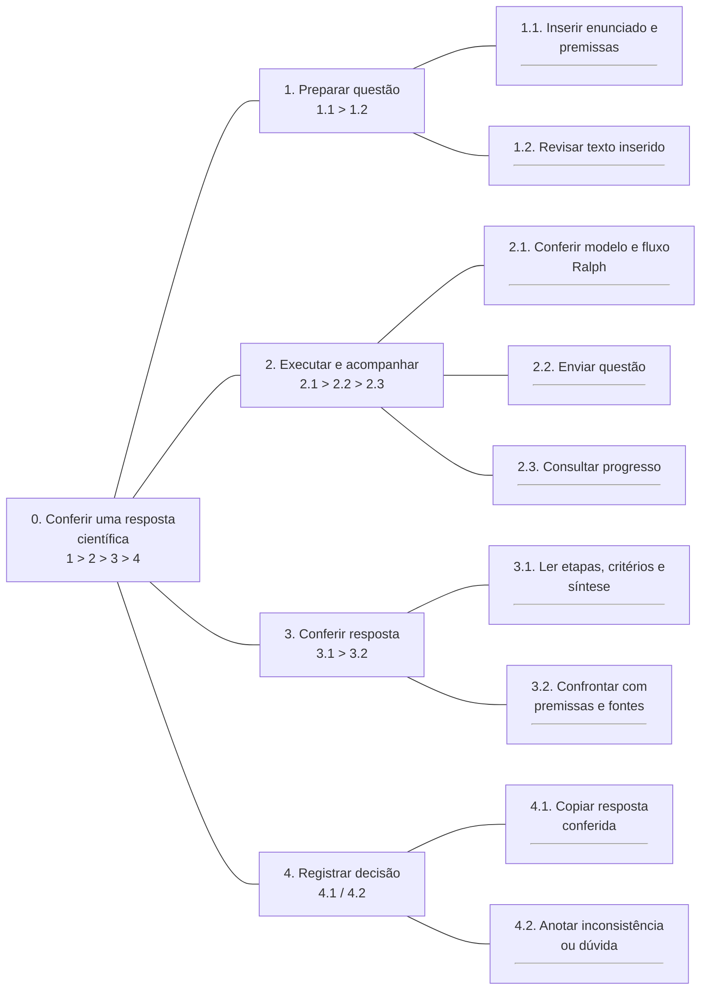
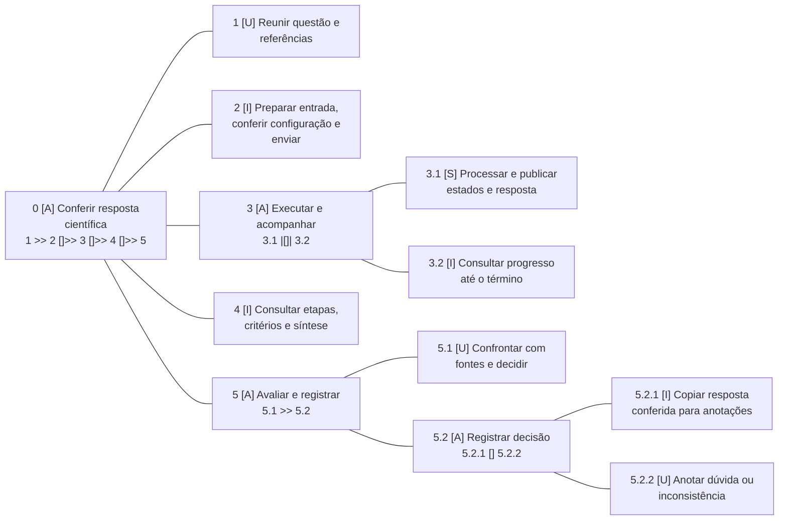
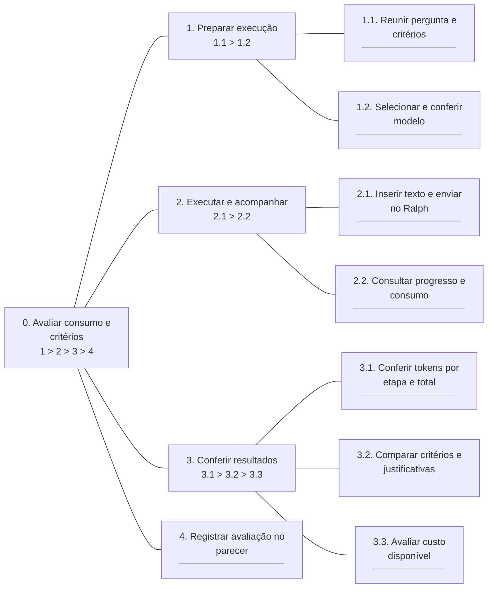
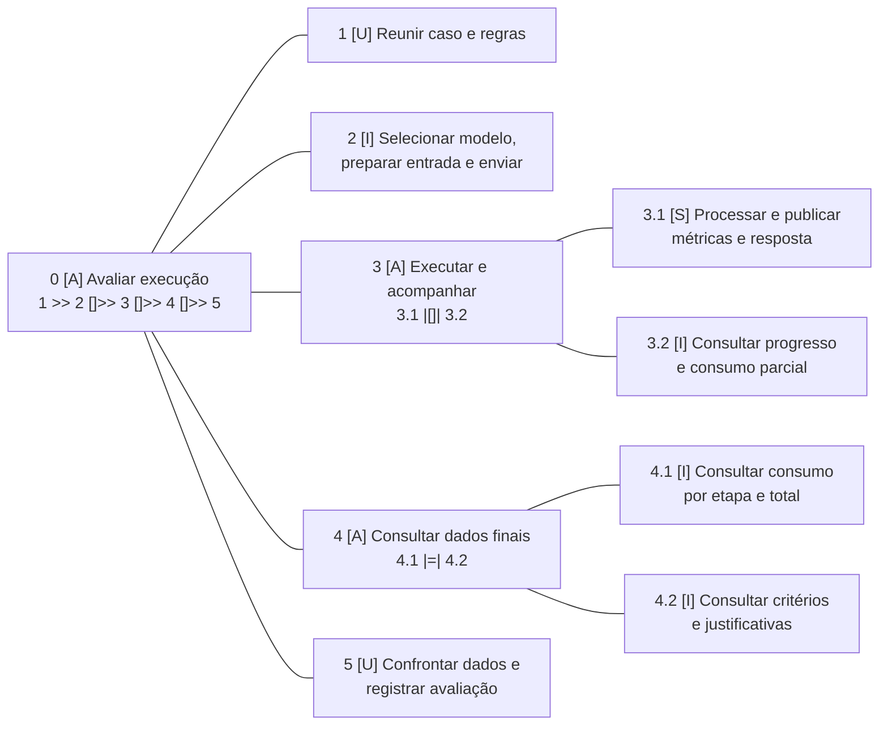
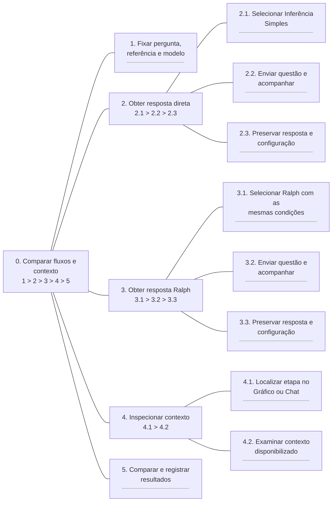
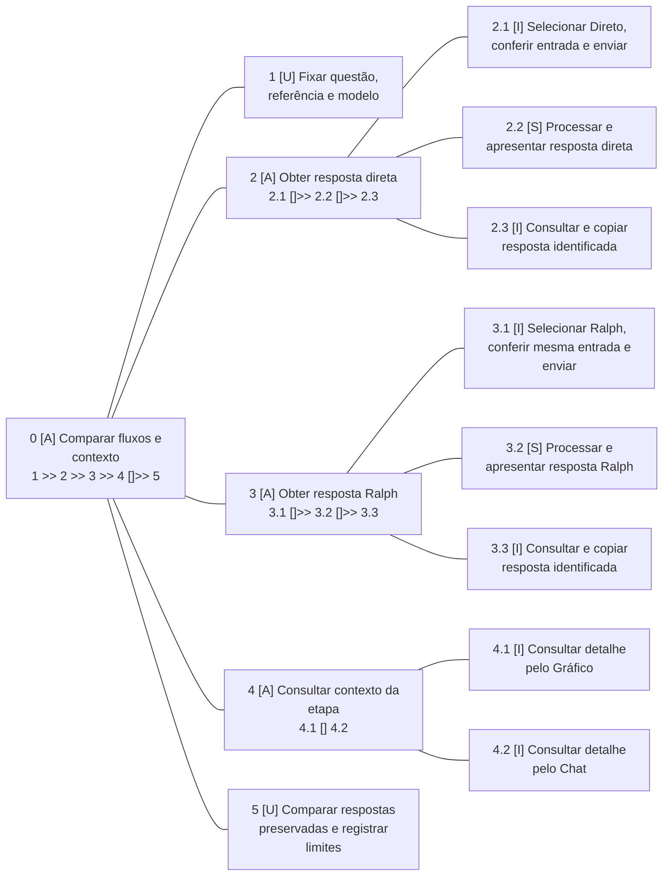
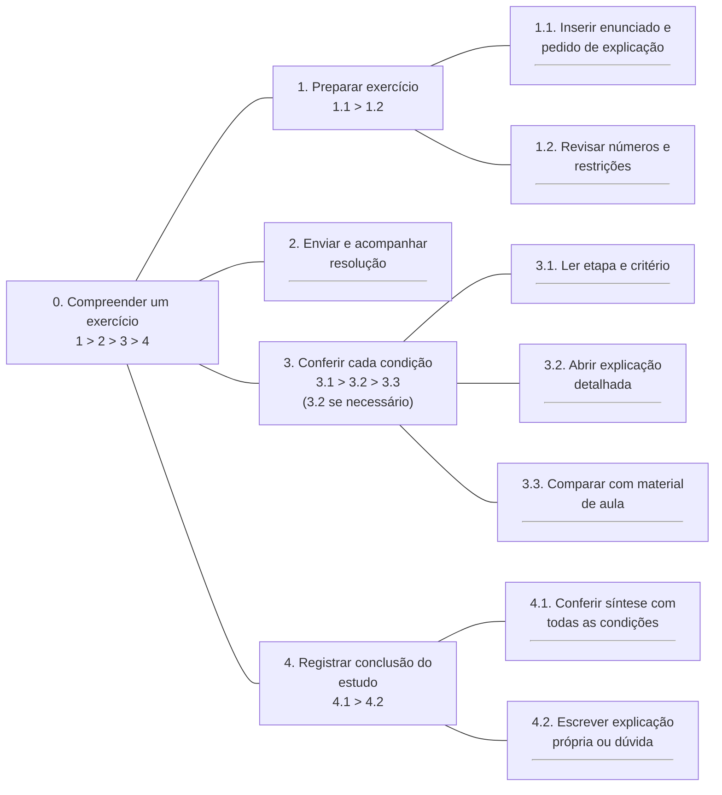
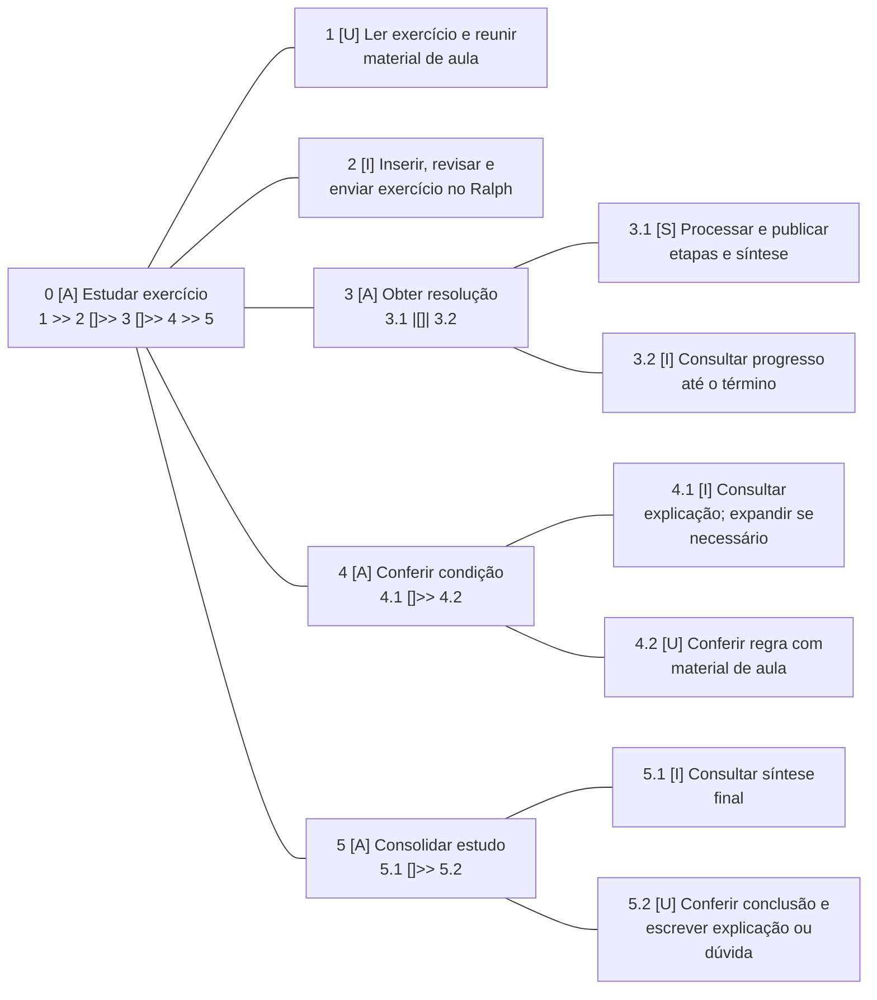

# Entrega 5 — Análise de tarefas: HTA, GOMS e CTT

**Data original:** 29/09/2026

**Revisão:** 04/11/2026

**Status:** 🟩 concluída — revisão documental

**Responsabilidade:** um HTA, um GOMS e um CTT por integrante, apresentados em sequência por aluno. São quatro tarefas e 12 modelos, com as autorias da entrega preservadas.

## Objetivo da atividade

Modelar tarefas importantes em três perspectivas: decomposição de objetivos e planos (HTA), metas e formas de realizá-las (GOMS) e relações temporais entre tarefas (CTT). Cada modelo tem uma interpretação textual.

### Entradas e delimitação

A organização segue o `moldes.md` fornecido na pasta de trabalho. A base do conteúdo são as [Entregas 1](01_conhecendo_o_problema.md), [2](02_analise_concorrencia.md), [3](03_personas_contexto_jornada.md) e [4](04_cenarios_problema.md).

O TCC já previa interface, conforme a Entrega 1. Aqui são modeladas ações de quem envia perguntas, acompanha execuções e avalia respostas. As tarefas T01–T04 e seus vínculos foram aproveitados da Entrega 5 anterior. Entregas posteriores à 5 não fundamentam esta revisão.

Os modelos são propostas de interação, não registros de testes com usuários. As frequências são estimativas; H01 (preferência pela timeline) e H02 (compreensão dos indicadores de critérios) permanecem abertas. Um critério aprovado pelo sistema não substitui a conferência humana. Anotações, pareceres e comparações podem ser feitos nos materiais externos das personas, sem novas telas de cadastro, histórico ou relatório.

## Seleção das tarefas

| ID | Tarefa | Persona/cenário de origem | Frequência/criticidade estimada | Autor responsável |
|---|---|---|---|---|
| T01 | Conferir uma resposta científica | P01 — Dra. Mariana Siqueira / C01; R01, R04; F01, F02, F04 | Frequente na pesquisa / alta | Pedro Henrique Correia de Oliveira — 22.222.009-7 |
| T02 | Avaliar consumo e critérios | P02 — Carlos Eduardo Prado / C02; R02, R04; F01, F02, F04 | A cada avaliação técnica / alta | Vitor Monteiro Vianna — 22.223.085-6 |
| T03 | Comparar fluxos e inspecionar contexto | P03 — Lucas Zanin / C03; R02, R03; F01–F04 | A cada experimento / alta | Pedro Henrique Satoru Lima Takahashi — 22.123.019-6 |
| T04 | Compreender um exercício | P04 — Beatriz Fagundes / C04; R01, R04; F01, F04 | A cada sessão de estudo / alta | Hugo Emílio Nomura — 22.123.051-9 |

P01–P04 são personas da Entrega 3; C01–C04, cenários da Entrega 4; F01–F04, requisitos da Entrega 1; R01–R04, relações na [rastreabilidade](../RASTREABILIDADE.md). A numeração dos nós é local a cada modelo.

### Como ler os modelos

- **HTA:** as ligações mostram a hierarquia; `>` indica sequência e `/` indica alternativa. As relações entre subtarefas aparecem abaixo do texto de cada objetivo decomposto. A linha inferior nas caixas das folhas identifica operações. Condições e repetições são detalhadas nos planos.
- **GOMS:** `GOAL` é uma meta; `METHOD` é uma maneira de alcançá-la; `SR` é a regra de seleção. Operadores externos são ações como clicar e digitar; internos são leitura, comparação e decisão. Quando há um caminho único, os operadores aparecem diretamente sob o objetivo, como no exemplo da aula. A análise é qualitativa, sem estimativas KLM.
- **CTT:** `U` = tarefa do usuário fora do harness; `I` = interação com o harness; `S` = processamento do sistema; `A` = composição abstrata de tarefas. As relações temporais estão no nó abstrato e na legenda; as arestas mostram a decomposição. Os tipos são identificados por letras em lugar dos ícones tradicionais.

Os oito diagramas Mermaid ficam no próprio Markdown, que também é sua fonte editável.

**Limite comum:** se houver falha técnica ou interrupção, identificar o estado e registrar a pendência, sem tratar saída parcial como conclusão da tarefa. Os modelos detalham o percurso principal e as decisões sobre o resultado, sem decompor mecanismos internos de recuperação do serviço.

---

## Aluno 1 — Pedro Henrique Correia de Oliveira

<a id="hta01"></a>

### HTA01 — T01: Conferir uma resposta científica

**Autor(a):** Pedro Henrique Correia de Oliveira — 22.222.009-7

#### Descrição da tarefa

Mariana precisa conferir se a resposta a uma questão científica respeita suas premissas. A tarefa começa com o enunciado e as referências disponíveis no laboratório e termina com uma decisão fundamentada de aproveitamento ou uma pendência identificada. A origem é P01/C01 e a jornada da Entrega 3.

#### Diagrama



*Figura 1 — HTA01. Fonte: elaboração da equipe, com base em P01/C01.*

#### Decomposição e planos

| ID | Objetivo/operação | Plano/ordem | Problema ou decisão de design observada |
|---|---|---|---|
| 0 | Conferir uma resposta científica | 1 > 2 > 3 > 4. | Receber uma resposta não encerra a conferência. |
| 1 | Preparar questão | 1.1 > 1.2; corrigir 1.1 se houver omissão. | Preservar as premissas originais. |
| 1.1 | Inserir enunciado e premissas | Digitar ou colar no campo de pergunta. | Usar entrada em linguagem natural. |
| 1.2 | Revisar texto inserido | Comparar com o enunciado original. | Manter símbolos, unidades e restrições. |
| 2 | Executar e acompanhar | 2.1 > 2.2 > 2.3. | Distinguir configuração, envio e processamento. |
| 2.1 | Conferir modelo e fluxo Ralph | Ajustar a seleção, se necessário. | Identificar a configuração usada. |
| 2.2 | Enviar questão | Acionar envio e conferir recebimento. | Apresentar confirmação de início. |
| 2.3 | Consultar progresso | Repetir a consulta nas atualizações até o estado final. | Distinguir conclusão e falha. |
| 3 | Conferir resposta | 3.1 > 3.2; repetir por premissa relevante. | O indicador automático não substitui a conferência. |
| 3.1 | Ler etapas, critérios e síntese | Abrir os detalhes necessários. | Disponibilizar justificativas dos critérios. |
| 3.2 | Confrontar com premissas e fontes | Comparar a dedução com as referências. | Apoiar a identificação de contradições. |
| 4 | Registrar decisão | 4.1 / 4.2: aproveitar se a conferência permitir; caso contrário, registrar pendência. | A decisão pertence à pesquisadora. |
| 4.1 | Copiar resposta conferida | Colar nas anotações externas e verificar o texto. | Preservar o conteúdo transferido. |
| 4.2 | Anotar inconsistência ou dúvida | Registrar a premissa e o trecho a revisar. | Não apresentar uma dúvida como validação. |

**Interpretação:** Preparar, executar e conferir são etapas diferentes. O aproveitamento depende da comparação com fontes, inclusive quando todos os critérios automáticos aparecem aprovados.

**Verificação do HTA:** a meta 0 é um objetivo do usuário; os planos cobrem preparação, execução e conclusão, com condições e repetições quando necessárias; as folhas descrevem ações e verificações, sem decompor o código.

<a id="goms01"></a>

### GOMS01 — T01: Conferir uma resposta científica

**Autor(a):** Pedro Henrique Correia de Oliveira — 22.222.009-7

#### Goal

`G0: Obter e conferir uma resposta científica para decidir seu aproveitamento.`

#### Métodos, operadores e regras de seleção

```text
GOAL G0: obter e conferir uma resposta científica
  GOAL G1: inserir a pergunta e suas premissas
    METHOD M1A: digitar a pergunta
      SR1A: usar quando o texto completo ainda não estiver em meio digital.
      OP externo: clicar no campo e digitar enunciado e premissas.
      OP interno: comparar o texto com o original.
      OP externo: corrigir eventuais omissões.
    METHOD M1B: colar a pergunta preparada
      SR1B: usar quando o texto completo já estiver em um documento digital.
      OP externo: selecionar e copiar o texto de origem.
      OP externo: clicar no campo de pergunta e colar.
      OP interno: conferir se símbolos e premissas foram preservados.
      OP externo: corrigir eventuais omissões.
  GOAL G2: iniciar a execução
    OP interno: conferir modelo e fluxo Ralph.
    OP externo: ajustar a seleção, se necessário, e clicar em enviar.
    OP interno: reconhecer a confirmação de recebimento.
  GOAL G3: acompanhar a execução
    OP interno: ler estado e etapa atual nas atualizações, até o término.
  GOAL G4: conferir a resposta
    OP externo: abrir os detalhes das etapas relevantes.
    OP interno: ler critérios, justificativas e síntese.
    OP interno: comparar cada premissa com as referências disponíveis.
  GOAL G5: registrar a decisão
    OP interno: decidir se a resposta pode ser aproveitada.
    OP externo: se puder, copiar para as anotações.
    OP interno: conferir o conteúdo colado.
    OP externo: se não puder aproveitar, anotar o trecho e a dúvida.
```

**Interpretação:** G1–G5 são sequenciais. Digitar e colar são métodos para a mesma entrada; a auditoria continua obrigatória nos dois caminhos. A conferência do conteúdo colado em G5 só ocorre no caminho de aproveitamento.

<a id="ctt01"></a>

### CTT01 — T01: Conferir uma resposta científica

**Autor(a):** Pedro Henrique Correia de Oliveira — 22.222.009-7

#### Descrição

O modelo distingue a preparação das referências, o envio, a execução acompanhada e o julgamento humano. A conferência final utiliza a resposta concluída.

#### Diagrama



*Figura 2 — CTT01. Fonte: elaboração da equipe, com base em P01/C01.*

#### Legenda e relações temporais usadas

| Operador/relação | Significado no diagrama | Exemplo no modelo |
|---|---|---|
| `>>` | Sequência: a segunda tarefa começa após a primeira. | Reunir referências antes de preparar a entrada. |
| `[]>>` | Sequência com passagem de informação. | A execução fornece a resposta para consulta e julgamento. |
| `\|[]\|` | Concorrência com comunicação. | Publicação de estados e consulta do progresso. |
| `[]` | Escolha de uma alternativa naquela ocorrência. | Copiar a resposta conferida ou anotar uma pendência. |

**Interpretação:** 3.2 admite consultas repetidas até o estado final. O julgamento em 5.1 orienta a escolha de 5.2. A cópia inclui conferir o texto nas anotações de destino. Se a execução falhar, registrar a pendência sem seguir para aproveitamento.

---

## Aluno 2 — Vitor Monteiro Vianna

<a id="hta02"></a>

### HTA02 — T02: Avaliar consumo e critérios

**Autor(a):** Vitor Monteiro Vianna — 22.223.085-6

#### Descrição da tarefa

Carlos precisa selecionar o modelo de uma execução e avaliar seu consumo e o atendimento às regras do caso. Começa com a pergunta e os critérios disponíveis e termina com uma avaliação registrada para seu parecer técnico. O contexto é a preparação de uma análise corporativa em notebook, conforme P02/C02.

#### Diagrama



*Figura 3 — HTA02. Fonte: elaboração da equipe, com base em P02/C02.*

#### Decomposição e planos

| ID | Objetivo/operação | Plano/ordem | Problema ou decisão de design observada |
|---|---|---|---|
| 0 | Avaliar consumo e critérios | 1 > 2 > 3 > 4. | Escolher o modelo é apenas parte da tarefa. |
| 1 | Preparar execução | 1.1 > 1.2. | Relacionar a escolha ao caso avaliado. |
| 1.1 | Reunir pergunta e critérios | Consultar o material do caso e identificar suas regras. | Manter as regras disponíveis para conferência. |
| 1.2 | Selecionar e conferir modelo | Manter a seleção se for a desejada; senão, alterar e conferir. | Exibir claramente o modelo escolhido. |
| 2 | Executar e acompanhar | 2.1 > 2.2. | Dar feedback de recebimento e execução. |
| 2.1 | Inserir texto e enviar no Ralph | Revisar pergunta, critérios e fluxo antes de enviar. | A tarefa usa texto, sem depender de upload. |
| 2.2 | Consultar progresso e consumo | Repetir nas atualizações até o estado final. | Distinguir consumo parcial e final. |
| 3 | Conferir resultados | 3.1 > 3.2 > 3.3. | Consumo e atendimento às regras são verificações diferentes. |
| 3.1 | Conferir tokens por etapa e total | Verificar a composição do total, incluindo tentativas adicionais exibidas. | Não somar um total às suas próprias parcelas. |
| 3.2 | Comparar critérios e justificativas | Confrontar cada justificativa com a regra do caso. | Aprovação automática não equivale a parecer humano. |
| 3.3 | Avaliar custo disponível | Com contagens e tarifas conhecidas, estimar na planilha; senão, registrar custo indeterminado. | Tokens não são um valor monetário. |
| 4 | Registrar avaliação no parecer | Anotar modelo, consumo, critérios, pendências e conclusão. | Uma avaliação desfavorável também é resultado válido. |

**Interpretação:** A configuração identifica o que foi avaliado. A telemetria apoia a análise de consumo, e as justificativas permitem conferir as regras. O registro reúne as duas análises sem afirmar viabilidade quando faltam dados.

**Verificação do HTA:** a meta 0 é um objetivo do usuário; os planos cobrem preparação, execução e conclusão, com condições e repetições quando necessárias; as folhas descrevem ações e verificações, sem decompor o código.

<a id="goms02"></a>

### GOMS02 — T02: Avaliar consumo e critérios

**Autor(a):** Vitor Monteiro Vianna — 22.223.085-6

#### Goal

`G0: Avaliar uma execução com modelo, consumo e atendimento aos critérios identificados.`

#### Métodos, operadores e regras de seleção

```text
GOAL G0: avaliar consumo e critérios de uma execução
  GOAL G1: deixar o modelo pretendido selecionado
    METHOD M1A: manter a seleção atual
      SR1A: usar quando o modelo exibido for o pretendido.
      OP interno: ler o nome do modelo selecionado.
      OP interno: comparar com o modelo previsto para a avaliação.
    METHOD M1B: alterar a seleção
      SR1B: usar quando o modelo exibido for diferente do pretendido.
      OP externo: abrir o seletor e selecionar o modelo pretendido.
      OP interno: conferir o nome exibido após a seleção.
  GOAL G2: executar o caso
    OP externo: inserir pergunta e critérios.
    OP interno: conferir texto e fluxo selecionado.
    OP externo: selecionar Ralph se necessário e clicar em enviar.
    OP interno: reconhecer o início e ler progresso e consumo até o término.
  GOAL G3: conferir consumo e critérios
    OP externo: abrir os detalhes de consumo por etapa.
    OP interno: ler contagens e conferir sua relação com o total.
    OP externo: abrir as justificativas dos critérios.
    OP interno: comparar cada justificativa com a regra do caso.
    OP interno: verificar se há tarifas e contagens suficientes para estimar custo.
    OP externo: se houver, registrar a estimativa na planilha; senão, anotar a falta.
  GOAL G4: registrar avaliação
    OP interno: decidir se a avaliação é favorável, desfavorável ou inconclusiva.
    OP externo: anotar modelo, consumo, critérios e conclusão no parecer externo.
```

**Interpretação:** G1–G4 são sequenciais. Carlos já tem o caso, suas regras e o modelo que pretende avaliar. Manter e trocar a seleção alcançam a mesma configuração; os dois caminhos exigem depois executar e conferir o caso. Não são acrescentados parâmetros avançados ou preços presumidos.

<a id="ctt02"></a>

### CTT02 — T02: Avaliar consumo e critérios

**Autor(a):** Vitor Monteiro Vianna — 22.223.085-6

#### Descrição

O sistema executa e publica métricas enquanto Carlos acompanha os dados. Ao final, ele consulta consumo e critérios e registra sua avaliação fora do harness.

#### Diagrama



*Figura 4 — CTT02. Fonte: elaboração da equipe, com base em P02/C02.*

#### Legenda e relações temporais usadas

| Operador/relação | Significado no diagrama | Exemplo no modelo |
|---|---|---|
| `>>` | Sequência entre tarefas. | Reunir o caso antes de configurar e enviar. |
| `[]>>` | Sequência com passagem de informação. | A execução fornece métricas; as consultas fornecem dados à avaliação. |
| `\|[]\|` | Concorrência com comunicação. | Publicar consumo enquanto Carlos o consulta. |
| `\|=\|` | Ambas são necessárias, em qualquer ordem, sem sobreposição. | Consultar consumo e consultar critérios. |

**Interpretação:** O acompanhamento se repete até o estado final. As duas consultas de 4 podem ocorrer em qualquer ordem, mas ambas terminam antes de 5. A ordem fixa do HTA/GOMS é um percurso possível. Se faltarem métricas ou tarifas, a avaliação registra essa limitação.

---

## Aluno 3 — Pedro Henrique Satoru Lima Takahashi

<a id="hta03"></a>

### HTA03 — T03: Comparar fluxos e inspecionar contexto

**Autor(a):** Pedro Henrique Satoru Lima Takahashi — 22.123.019-6

#### Descrição da tarefa

Lucas quer comparar a inferência direta com o Ralph Loop para a mesma questão e inspecionar o contexto da execução Ralph. Começa com uma pergunta, uma referência de resposta e um modelo definido. Termina com as duas respostas comparadas e as limitações registradas. O contexto é seu ambiente de experimentação, conforme P03/C03.

#### Diagrama



*Figura 5 — HTA03. Fonte: elaboração da equipe, com base em P03/C03.*

#### Decomposição e planos

| ID | Objetivo/operação | Plano/ordem | Problema ou decisão de design observada |
|---|---|---|---|
| 0 | Comparar fluxos e contexto | 1 > 2 > 3 > 4 > 5. | Comparar exige obter duas respostas. |
| 1 | Fixar pergunta, referência e modelo | Registrar as condições comuns do experimento. | Evitar diferenças não percebidas entre os casos. |
| 2 | Obter resposta direta | 2.1 > 2.2 > 2.3. | Preservar o resultado antes da próxima execução. |
| 2.1 | Selecionar Inferência Simples | Conferir fluxo e modelo. | Diferenciar fluxo e modo de visualização. |
| 2.2 | Enviar questão e acompanhar | Usar a pergunta fixada e consultar o estado até o término. | Identificar a resposta como direta. |
| 2.3 | Preservar resposta e configuração | Copiar para registro externo e conferir. | Não depender de histórico persistente. |
| 3 | Obter resposta Ralph | 3.1 > 3.2 > 3.3. | Manter as condições da comparação. |
| 3.1 | Selecionar Ralph com as mesmas condições | Conferir pergunta e modelo antes do envio. | Alterar somente o fluxo comparado. |
| 3.2 | Enviar questão e acompanhar | Consultar atualizações até o estado final. | Não misturar execuções. |
| 3.3 | Preservar resposta e configuração | Copiar para outro registro, sem substituir a resposta direta. | Manter os dois resultados identificados. |
| 4 | Inspecionar contexto | 4.1 > 4.2; repetir para as etapas relevantes. | Oferecer detalhes sob demanda. |
| 4.1 | Localizar etapa no Gráfico ou Chat | Usar a estrutura de tarefas ou a sequência textual. | Os dois modos mostram a mesma execução. |
| 4.2 | Examinar contexto disponibilizado | Conferir entradas e aprendizados transferidos; anotar dados ausentes. | Um indicador isolado não comprova isolamento de contexto. |
| 5 | Comparar e registrar resultados | Confrontar ambas as respostas com a referência; anotar diferenças e limites. | Um caso não demonstra ganho geral de acurácia. |

**Interpretação:** As execuções são sequenciais neste recorte para simplificar a comparação. Se uma falhar, a comparação fica incompleta; se faltarem informações de contexto, essa parte da avaliação fica inconclusiva.

**Verificação do HTA:** a meta 0 é um objetivo do usuário; os planos cobrem preparação, execução e conclusão, com condições e repetições quando necessárias; as folhas descrevem ações e verificações, sem decompor o código.

<a id="goms03"></a>

### GOMS03 — T03: Comparar fluxos e inspecionar contexto

**Autor(a):** Pedro Henrique Satoru Lima Takahashi — 22.123.019-6

#### Goal

`G0: Comparar duas respostas à mesma questão e registrar as evidências de contexto disponíveis.`

#### Métodos, operadores e regras de seleção

```text
GOAL G0: comparar respostas e inspecionar contexto
  GOAL G1: definir condições comuns
    OP interno: ler a pergunta, a referência e o modelo pretendido.
    OP externo: anotar essas condições no registro do experimento.
  GOAL G2: obter a resposta direta
    OP externo: selecionar Inferência Simples e inserir a pergunta.
    OP interno: conferir pergunta e modelo.
    OP externo: clicar em enviar.
    OP interno: acompanhar o estado até a resposta final.
    OP externo: copiar a resposta e registrar fluxo e modelo.
  GOAL G3: obter a resposta Ralph
    OP externo: selecionar Ralph e inserir a mesma pergunta.
    OP interno: conferir que modelo e pergunta foram mantidos.
    OP externo: clicar em enviar.
    OP interno: acompanhar o estado até a resposta final.
    OP externo: copiar em outro registro, identificando fluxo e modelo.
  GOAL G4: inspecionar o contexto de uma etapa Ralph
    METHOD M4A: acessar pela visão Gráfico
      SR4A: usar se preferir localizar pela estrutura de tarefas;
             sem preferência, usar se Gráfico já estiver ativo.
      OP externo: selecionar Gráfico, se necessário.
      OP interno: localizar a etapa na estrutura.
      OP externo: abrir os detalhes da etapa.
      OP interno: conferir entradas, contexto e aprendizados disponíveis.
    METHOD M4B: acessar pela visão Chat
      SR4B: usar se preferir localizar pela sequência textual;
             sem preferência, usar se Chat já estiver ativo.
      OP externo: selecionar Chat, se necessário.
      OP interno: localizar o trecho identificado com a etapa.
      OP externo: abrir seus detalhes, se estiverem recolhidos.
      OP interno: conferir entradas, contexto e aprendizados disponíveis.
  GOAL G5: comparar e registrar
    OP interno: confrontar cada resposta com a mesma referência.
    OP interno: identificar diferenças, equivalências e dados ausentes.
    OP externo: anotar a comparação e os limites da inspeção de contexto.
```

**Interpretação:** G1–G5 são sequenciais, e G4 pode ser repetido por etapa. Gráfico e Chat são formas de acessar a mesma informação, quando disponível. Trocar a visualização não inicia inferência. G2 e G3 são obrigatórios: os fluxos não são alternativas quando a meta é compará-los.

<a id="ctt03"></a>

### CTT03 — T03: Comparar fluxos e inspecionar contexto

**Autor(a):** Pedro Henrique Satoru Lima Takahashi — 22.123.019-6

#### Descrição

A comparação depende de obter e preservar os dois resultados. As execuções ocorrem em sequência; a consulta dos detalhes tem escolha entre Gráfico e Chat.

#### Diagrama



*Figura 6 — CTT03. Fonte: elaboração da equipe, com base em P03/C03.*

#### Legenda e relações temporais usadas

| Operador/relação | Significado no diagrama | Exemplo no modelo |
|---|---|---|
| `>>` | Sequência entre tarefas necessárias. | Obter a resposta direta antes da resposta Ralph. |
| `[]>>` | Sequência com passagem de informação. | A pergunta alimenta a execução; a resposta fica disponível para cópia. |
| `[]` | Uma forma de acesso por consulta. | Consultar a etapa pelo Gráfico ou pelo Chat. |

**Interpretação:** A escolha de 4 não elimina nenhuma execução. A consulta pode ser repetida para outra etapa ou por outro modo, mantendo a mesma execução Ralph. O nó 5 usa os resultados preservados em 2 e 3 e os dados consultados em 4. Sem duas respostas, registra-se comparação incompleta. Este CTT destaca a dependência entre os resultados; o acompanhamento durante cada execução está detalhado no HTA e no GOMS.

---

## Aluno 4 — Hugo Emílio Nomura

<a id="hta04"></a>

### HTA04 — T04: Compreender um exercício

**Autor(a):** Hugo Emílio Nomura — 22.123.051-9

#### Descrição da tarefa

Beatriz precisa entender a resolução de um exercício e conferir se todas as condições foram consideradas. Começa com o enunciado e o material de aula e termina com uma explicação própria ou uma dúvida específica registrada. O contexto é o estudo noturno em notebook, conforme P04/C04.

#### Diagrama



*Figura 7 — HTA04. Fonte: elaboração da equipe, com base em P04/C04.*

#### Decomposição e planos

| ID | Objetivo/operação | Plano/ordem | Problema ou decisão de design observada |
|---|---|---|---|
| 0 | Compreender um exercício | 1 > 2 > 3 > 4. | Receber uma alternativa não comprova compreensão. |
| 1 | Preparar exercício | 1.1 > 1.2; corrigir o texto se faltar alguma condição. | Não exigir configuração avançada para estudar. |
| 1.1 | Inserir enunciado e pedido de explicação | Digitar ou colar em linguagem natural. | Usar um campo simples e legível. |
| 1.2 | Revisar números e restrições | Conferir o texto com a lista original. | Preservar condições como “maior que 2”. |
| 2 | Enviar e acompanhar resolução | Conferir fluxo Ralph, enviar e consultar progresso até o término. | Deixar claro quando está processando ou terminou. |
| 3 | Conferir cada condição | Por condição: 3.1 > 3.3; inserir 3.2 entre elas se houver dúvida ou resumo insuficiente. | O detalhe pode ser necessário mesmo com critério aprovado. |
| 3.1 | Ler etapa e critério | Identificar a condição tratada e sua justificativa. | Usar texto compreensível junto ao indicador. |
| 3.2 | Abrir explicação detalhada | Expandir a etapa que precisa de esclarecimento. | Não obrigar a leitura de todos os detalhes. |
| 3.3 | Comparar com material de aula | Conferir a regra e o cálculo nas anotações. | Permitir identificar contradições. |
| 4 | Registrar conclusão do estudo | 4.1 > 4.2. | Finalizar com o que foi compreendido e o que falta. |
| 4.1 | Conferir síntese com todas as condições | Comparar conclusão e verificações anteriores. | Evitar aceitar uma alternativa que ignore uma condição. |
| 4.2 | Escrever explicação própria ou dúvida | Se compreendeu, explicar; senão, anotar a condição que precisa estudar. | Dúvida localizada não equivale a aprendizado concluído. |

**Interpretação:** O detalhe é acionado pela necessidade de compreensão, e não apenas por falha automática. Em C04, Beatriz confere separadamente primalidade, paridade e a condição de ser maior que 2 antes de aceitar a interseção.

**Verificação do HTA:** a meta 0 é um objetivo do usuário; os planos cobrem preparação, execução e conclusão, com condições e repetições quando necessárias; as folhas descrevem ações e verificações, sem decompor o código.

<a id="goms04"></a>

### GOMS04 — T04: Compreender um exercício

**Autor(a):** Hugo Emílio Nomura — 22.123.051-9

#### Goal

`G0: Conferir a resolução de um exercício e explicar a conclusão ou identificar a dúvida restante.`

#### Métodos, operadores e regras de seleção

```text
GOAL G0: compreender a resolução de um exercício
  GOAL G1: preparar o exercício
    OP externo: clicar no campo e inserir enunciado e pedido de explicação.
    OP interno: conferir números e condições com o original.
    OP externo: corrigir o texto, se necessário.
  GOAL G2: obter a resolução
    OP interno: conferir o fluxo Ralph.
    OP externo: selecionar Ralph se necessário e clicar em enviar.
    OP interno: reconhecer o início e acompanhar o estado até o término.
  GOAL G3: conferir a explicação de uma condição
    OP interno: ler a condição e sua justificativa resumida.
    METHOD M3A: usar a explicação resumida
      SR3A: usar quando o resumo explicar a regra sem deixar dúvida.
      OP interno: identificar a regra apresentada no resumo.
      OP interno: comparar a aplicação com as anotações de aula.
    METHOD M3B: consultar a explicação detalhada
      SR3B: usar quando houver dúvida, contradição ou resumo insuficiente.
      OP externo: clicar para expandir a etapa.
      OP interno: ler a explicação detalhada da condição.
      OP interno: comparar a regra aplicada com as anotações de aula.
  GOAL G4: consolidar o estudo
    OP interno: ler a síntese e confrontá-la com as condições verificadas.
    OP interno: decidir se consegue explicar a conclusão.
    OP externo: escrever no caderno a explicação própria ou a dúvida específica.
```

**Interpretação:** G1–G4 são sequenciais, e G3 se repete por condição. Os métodos conferem a mesma condição com níveis de detalhe diferentes. Se M3A revelar dúvida, usa-se M3B; persistindo a dúvida, ela é registrada em G4. O modelo pressupõe familiaridade com os controles, não domínio do exercício, e não estima tempo de aprendizagem.

<a id="ctt04"></a>

### CTT04 — T04: Compreender um exercício

**Autor(a):** Hugo Emílio Nomura — 22.123.051-9

#### Descrição

O modelo começa na leitura do exercício e termina no registro pessoal do estudo. A execução do sistema é distinta da conferência e da explicação produzida pela estudante.

#### Diagrama



*Figura 8 — CTT04. Fonte: elaboração da equipe, com base em P04/C04.*

#### Legenda e relações temporais usadas

| Operador/relação | Significado no diagrama | Exemplo no modelo |
|---|---|---|
| `>>` | A próxima tarefa depende do término da anterior. | Conferir as condições antes de consolidar o estudo. |
| `[]>>` | A tarefa seguinte recebe informação da anterior. | Usar a explicação consultada na conferência com o material de aula. |
| `\|[]\|` | Execução e acompanhamento comunicam-se no mesmo intervalo. | Publicar estados enquanto Beatriz consulta o progresso. |

**Interpretação:** 3.2 se repete até o estado final. O conjunto 4 é repetido por condição; depois, 5 relaciona a síntese às verificações. Expandir a explicação em 4.1 é condicional. O registro de uma dúvida não significa que a meta de compreensão foi atingida.

---

## Síntese da equipe

| Problema identificado | Decisão de interação proposta | Origem | O que observar no protótipo e no teste |
|---|---|---|---|
| Uma resposta convincente pode omitir premissas. | Expor critérios e justificativas junto às etapas. | T01, T02, T04; H02 | A pessoa identifica uma condição não atendida e explica o motivo? |
| Espera sem estado claro gera incerteza. | Mostrar recebimento, progresso e estado final. | T01–T04; F04 | A pessoa distingue execução ativa, conclusão e falha? |
| Tokens agregados não explicam o consumo de uma execução. | Mostrar consumo por etapa e total, separando valores parciais. | T02; R02 | A pessoa localiza o consumo e reconhece dados insuficientes para estimar custo? |
| Alternar fluxo e alternar visualização são ações diferentes. | Identificar Direto/Ralph e Gráfico/Chat separadamente. | T03; F03, F04 | A pessoa obtém duas respostas sem confundir visualização com nova execução? |
| Ler a resposta não basta para compreender um exercício. | Permitir consultar detalhes e conferir cada condição. | T04; R01, R04 | A pessoa explica a conclusão ou aponta a condição que ainda não entendeu? |

As quatro tarefas devem orientar o protótipo e o teste de usabilidade. T01 é prioritária por corresponder à persona primária; T02 verifica configuração e consumo, T03 verifica comparação e inspeção, e T04 verifica compreensão das explicações. Essas são propostas de avaliação, sem resultados medidos nesta entrega.

## Rastreabilidade e referências

Os vínculos individuais estão na [matriz de rastreabilidade](../RASTREABILIDADE.md). As descrições, interpretações e decisões de cada modelo estão neste relatório. A base conceitual utilizada é a de Barbosa e Silva (2010), registrada na [bibliografia](../BIBLIOGRAFIA.md#fundamentos-de-ihc-e-design-de-interação).

Da transcrição fornecida, foram usados os trechos 2:27–7:22 (elementos GOMS), 8:31–8:46 (organização textual), 13:21–13:42 e 21:22–22:55 (decomposição, regras e operadores), 31:06–36:53 (categorias CTT) e 37:47–42:33 (relações temporais). Os materiais de apoio `hta.md`, `goms_e_ctt.md`, `moldes.md` e `transcricao_goms.txt` não estão incluídos neste repositório.

## Histórico de revisões

| Data | Revisão |
|---|---|
| 29/09/2026 | Data original da entrega. |
| 12/10/2026 | Revisão anterior de planos, métodos e relações temporais. |
| 04/11/2026 | Organização por aluno segundo o molde; simplificação dos 12 modelos; diagramas editáveis no Markdown; justificativas individuais baseadas nas Entregas 1–4 e nos materiais fornecidos. |

## Checklist

- [x] Cada integrante possui um HTA, um GOMS e um CTT em sequência.
- [x] Cada artefato identifica autor, matrícula e tarefa.
- [x] Os oito diagramas são legíveis e têm fonte editável no próprio Markdown.
- [x] HTA contém planos, além da hierarquia.
- [x] GOMS distingue objetivos, operadores, métodos e regras de seleção.
- [x] CTT identifica tipos de tarefa e relações temporais utilizadas.
- [x] Há interpretação textual para cada modelo.
- [x] As tarefas estão ligadas às personas e aos cenários na rastreabilidade.
- [x] Os modelos descrevem o uso humano da contribuição, sem decompor o código.
- [x] Registros e consultas foram escolhidos por sua relação com o objetivo do usuário.
- [x] Há descrição e interpretação individual para cada um dos 12 modelos.
- [x] Hipóteses e propostas estão separadas de evidências de testes com usuários.
