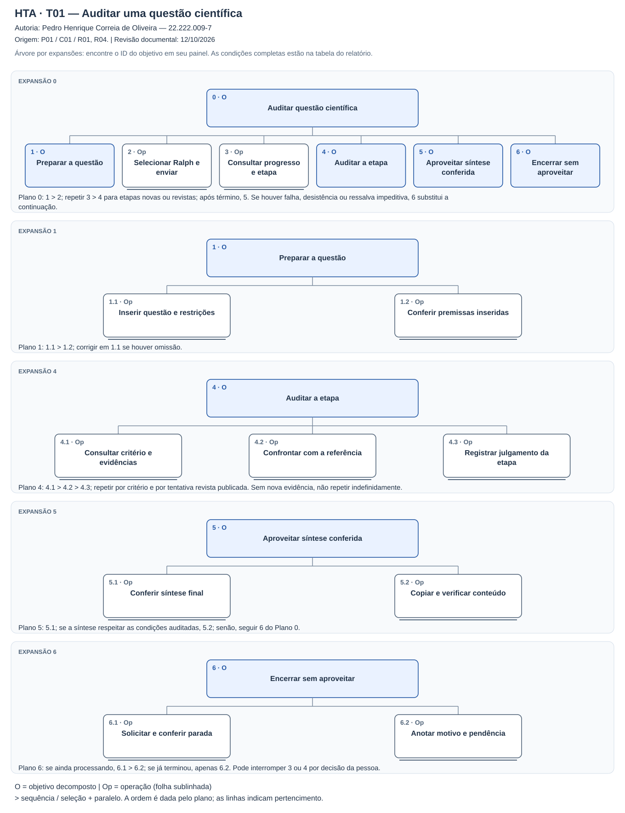
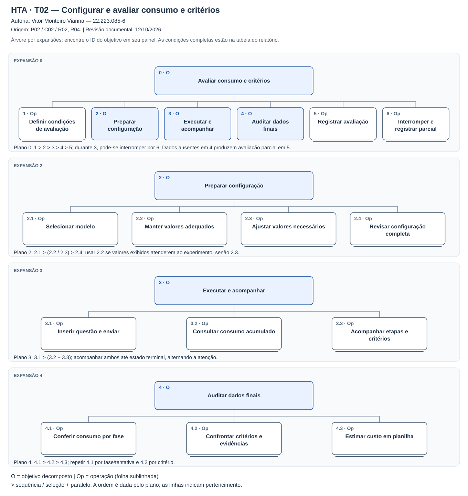
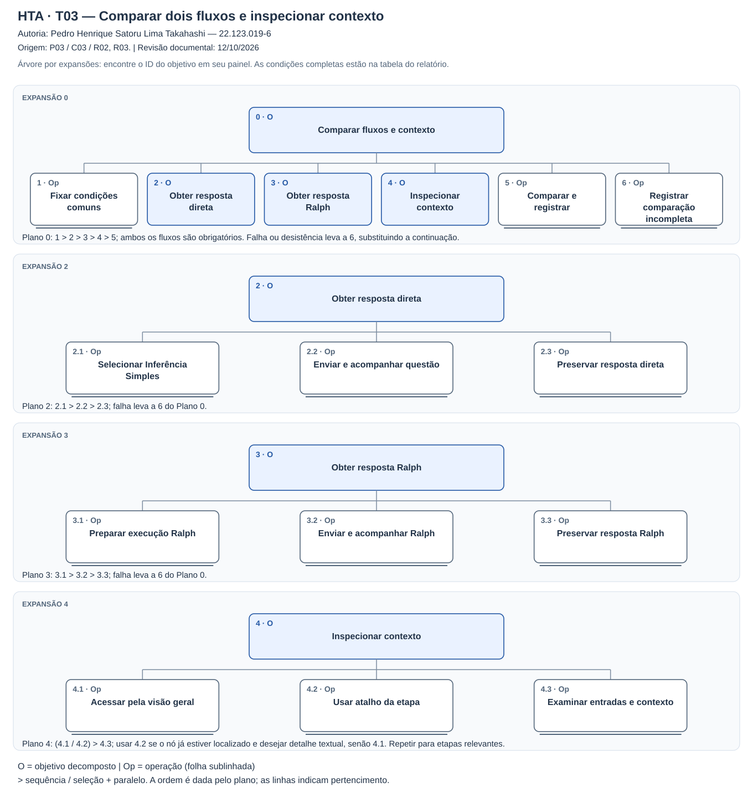
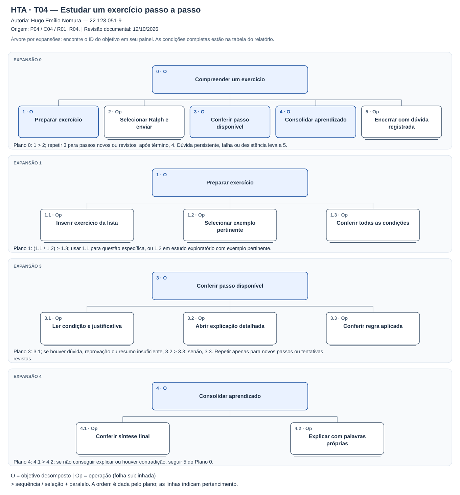
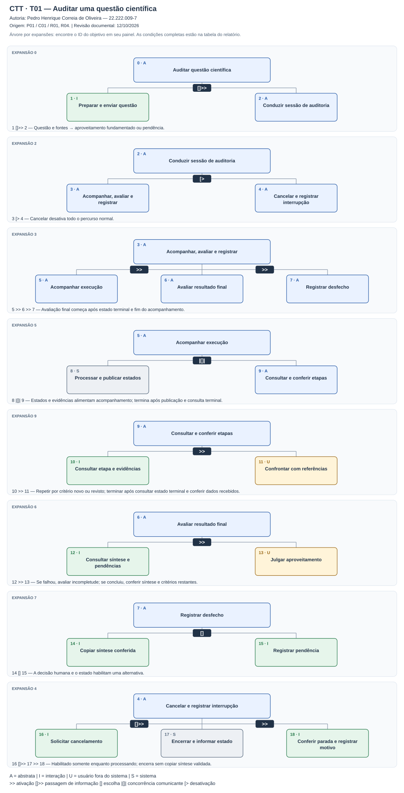
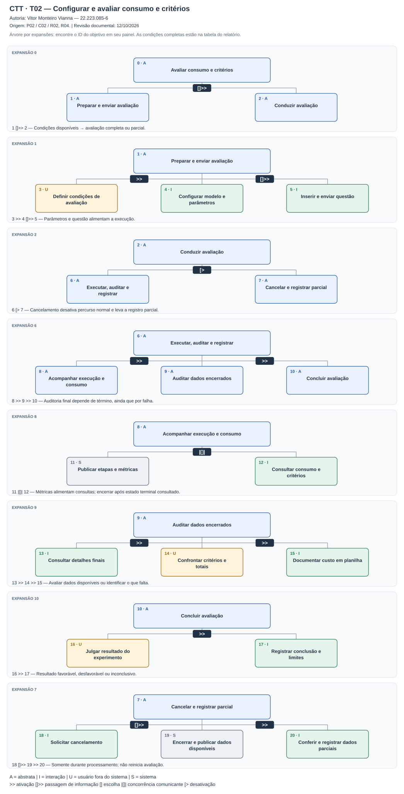
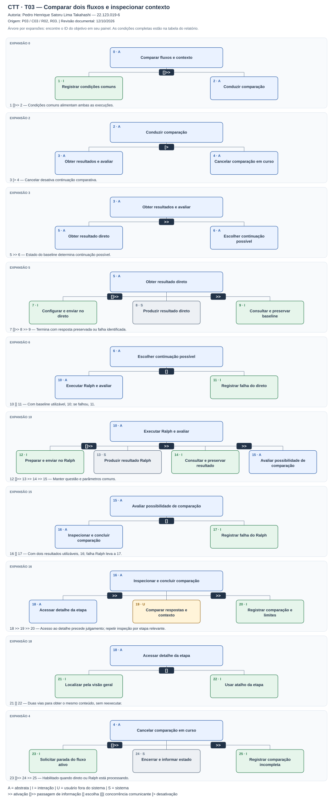
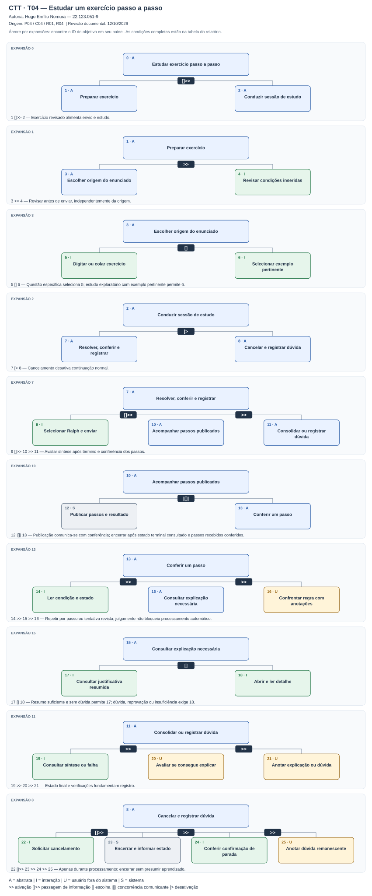

# Entrega 5 — Análise de tarefas: HTA, GOMS e CTT

**Data original:** 29/09/2026

**Revisão:** 12/10/2026

**Status:** 🟩 Concluída — revisão documental; validação com usuários ainda não realizada.

**Responsabilidade:** 1 HTA, 1 GOMS e 1 CTT por integrante: 4 tarefas e 12 modelos. Autorias registradas na entrega preservadas.

## Objetivo e fundamentação

Descrever os objetivos humanos, a organização das ações e as relações temporais de uso do harness. A fundamentação é o material da disciplina, identificado como Barbosa e Silva (2010):

- [hta.md](../hta.md): objetivos, subobjetivos, operações e planos; entrada, ação, feedback, problemas e recomendações.
- [goms_e_ctt.md](../goms_e_ctt.md): metas, operadores, métodos e regras de seleção; categorias e relações temporais de tarefas em CTT.

Os modelos derivam das [necessidades da Entrega 1](01_conhecendo_o_problema.md), da [análise da Entrega 2](02_analise_concorrencia.md), das [personas da Entrega 3](03_personas_contexto_jornada.md) e dos [cenários da Entrega 4](04_cenarios_problema.md), usando os IDs da [matriz de rastreabilidade](../RASTREABILIDADE.md). Conforme a Entrega 1, o TCC **já previa interface**. O recorte é a configuração, o acompanhamento, a inspeção e o aproveitamento dos resultados pelas pessoas, não as rotinas internas do algoritmo.

### Premissas e limites

1. Os modelos e as decisões de interface são propostas de projeto. Frequências e prioridades não foram medidas; H01 (preferência por timeline) e H02 (compreensão dos indicadores de critérios) permanecem abertas.
2. Os controles nomeados são requisitos da interação proposta, não comprovação de implementação. Não se pressupõem upload de dossiê, relatório automático, presets recomendados, atalho de envio ou limite fixo de três tentativas.
3. “Aprovado” informa uma verificação automática. Não garante correção científica, conformidade ou aprendizado. A pessoa confere evidências e decide sobre o resultado.
4. Tokens e o indicador de *Fresh Context* auxiliam a inspeção. Avaliar contexto exige examinar as entradas disponibilizadas por etapa, distinguindo histórico integral e aprendizados deliberadamente transferidos. Sem esses dados, registrar “evidência insuficiente”.
5. Limite de saída por chamada não é teto financeiro da execução inteira. Retentativas entram no consumo acumulado. T02 usa tarifas fornecidas para o experimento, sem assumir preços atuais, determinismo por temperatura baixa ou superioridade de um modelo.
6. Falha, cancelamento e evidência insuficiente são encerramentos distintos de atingir a meta. Uma nova execução exige nova decisão humana.

## Seleção e rastreabilidade

| ID | Objetivo humano | Origem | Frequência / prioridade presumida | Autoria dos três modelos |
|---|---|---|---|---|
| T01 | Submeter questão científica e auditar etapas e síntese para decidir seu aproveitamento | P01 — Dra. Mariana Siqueira; C01; R01, R04; F01, F04; H01, H02 | Diária / crítica | Pedro Henrique Correia de Oliveira — 22.222.009-7 |
| T02 | Configurar execução e avaliar consumo e observância dos critérios do dossiê | P02 — Carlos Eduardo Prado; C02; R02, R04; F01, F02, F04; H02 | Semanal / alta | Vitor Monteiro Vianna — 22.223.085-6 |
| T03 | Executar a mesma questão nos dois fluxos, inspecionar contexto e comparar resultados | P03 — Lucas Zanin; C03; R02, R03; F02, F03, F04; H01 | Diária / alta | Pedro Henrique Satoru Lima Takahashi — 22.123.019-6 |
| T04 | Submeter exercício e compreender a aplicação de cada condição até a conclusão | P04 — Beatriz Fagundes; C04; R01, R04; F01, F04; H01, H02 | Diária / crítica | Hugo Emílio Nomura — 22.123.051-9 |

F01–F04 são requisitos da Entrega 1; R01–R04 são relações da matriz. Os IDs de nós são locais a cada modelo, sem equivalência numérica obrigatória entre técnicas.

## 1. Análise Hierárquica de Tarefas (HTA)

**O** indica objetivo decomposto; **Op** indica operação, folha da hierarquia. A decomposição termina em uma ação ou verificação identificável, sem chegar aos movimentos físicos detalhados em GOMS. A árvore expressa pertencimento; o plano expressa ordem.

Conforme [hta.md](../hta.md), `1 > 2` é sequência, `1 / 2` é seleção e `1 + 2` é paralelo. No acompanhamento paralelo, a pessoa alterna sua atenção entre objetivos no mesmo intervalo; não se exige leitura simultânea. Todo objetivo decomposto tem plano com condições de escolha, repetição e saída.

### HTA — T01: Auditar uma questão científica

**Autor:** Pedro Henrique Correia de Oliveira — 22.222.009-7

**Persona/cenário/necessidades:** P01 / C01 / R01, R04.

**Objetivo:** decidir se uma dedução do tipo GPQA respeita as premissas e pode ser aproveitada no manuscrito. **Entrada:** enunciado, restrições e referências científicas disponíveis; tela de entrada aberta. **Contexto:** laboratório, consulta a referências em outra janela e pressão de prazo. **Sucesso:** critérios e síntese conferidos, conteúdo copiado e verificado no destino. **Encerramento sem sucesso:** falha, cancelamento ou inconsistência não resolvida, com motivo anotado.

*Figura 1 — HTA T01. Fonte: elaboração da equipe, revisada conforme hta.md. Cada painel expande um objetivo da mesma árvore, identificado pelo número.*

| ID | Tipo | Objetivo / operação | Plano ou ação | Entrada → feedback | Problema / recomendação |
|---|---|---|---|---|---|
| 0 | O | Auditar questão científica | Plano 0: 1 > 2; repetir 3 > 4 para etapas novas ou revistas; após término, 5. Se houver falha, desistência ou ressalva impeditiva, 6 substitui a continuação. | Questão e fontes → decisão fundamentada. | Término não significa correção. |
| 1 | O | Preparar a questão | Plano 1: 1.1 > 1.2; corrigir em 1.1 se houver omissão. | Enunciado → entrada revisada. | Preservar símbolos e restrições. |
| 1.1 | Op | Inserir questão e restrições | Digitar ou colar o texto no campo de entrada. | Texto original → conteúdo visível. | Permitir revisão de textos longos. |
| 1.2 | Op | Conferir premissas inseridas | Comparar entrada e original, condição por condição. | Entrada → omissões identificadas ou revisão concluída. | Evidenciar unidades e restrições. |
| 2 | Op | Selecionar Ralph e enviar | Selecionar o fluxo, acionar Enviar e verificar recebimento. | Questão revisada → início confirmado. | Diferenciar seleção de fluxo e envio. |
| 3 | Op | Consultar progresso e etapa | Identificar estado e próxima etapa disponível. | Execução ativa → etapa ou estado terminal identificado. | Distinguir processando, concluído, falhou e cancelado. |
| 4 | O | Auditar a etapa | Plano 4: 4.1 > 4.2 > 4.3; repetir por critério e por tentativa revista publicada. Sem nova evidência, não repetir indefinidamente. | Etapa disponível → julgamento humano. | Auditoria humana não dispara autocorreção. |
| 4.1 | Op | Consultar critério e evidências | Ler estado e abrir dedução, justificativa e contexto disponíveis. | Critério → evidências acessíveis ou ausência indicada. | Permitir detalhes também em critérios aprovados. |
| 4.2 | Op | Confrontar com a referência | Comparar a condição e a dedução com fontes e premissas. | Evidência e fonte → coerência, divergência ou insuficiência. | Badge não substitui comparação. |
| 4.3 | Op | Registrar julgamento da etapa | Anotar aceitação, ressalva ou espera por retentativa já em curso. | Comparação → decisão vinculada à tentativa. | Identificar qual versão foi examinada. |
| 5 | O | Aproveitar síntese conferida | Plano 5: 5.1; se a síntese respeitar as condições auditadas, 5.2; senão, seguir 6 do Plano 0. | Execução concluída → conteúdo conferido no destino. | Não aproveitar resultado parcial como validado. |
| 5.1 | Op | Conferir síntese final | Confrontar conclusão com as verificações das etapas. | Síntese e anotações → decisão sobre aproveitamento. | Manter ressalvas visíveis. |
| 5.2 | Op | Copiar e verificar conteúdo | Copiar a síntese, colar nas anotações e conferir o texto no destino. | Conteúdo aprovado → transferência verificada. | Dar feedback de cópia. |
| 6 | O | Encerrar sem aproveitar | Plano 6: se ainda processando, 6.1 > 6.2; se já terminou, apenas 6.2. Pode interromper 3 ou 4 por decisão da pessoa. | Falha, dúvida ou desistência → pendência registrada. | Não forçar reexecução. |
| 6.1 | Op | Solicitar e conferir parada | Acionar Cancelar e aguardar confirmação terminal. | Execução ativa → cancelada, ou concluída antes de aceitar o pedido. | Pedido não equivale a parada confirmada. |
| 6.2 | Op | Anotar motivo e pendência | Registrar nas anotações por que a conclusão não foi aproveitada. | Estado terminal → pendência identificada. | Nova execução exige nova decisão. |

### HTA — T02: Configurar e avaliar consumo e critérios

**Autor:** Vitor Monteiro Vianna — 22.223.085-6

**Persona/cenário/necessidades:** P02 / C02 / R02, R04.

**Objetivo:** documentar consumo e verificações para subsidiar avaliação técnica e econômica. **Entrada:** questão baseada no dossiê, critérios, orçamento, configuração e tarifas do experimento, quando disponíveis. **Contexto:** preparação de avaliação corporativa no notebook, com planilha externa. **Sucesso:** parâmetros usados, consumo e critérios registrados com conclusão e limitações; uma avaliação desfavorável também conclui a tarefa. **Encerramento parcial:** dados ausentes, falha ou cancelamento, com pendências explícitas.

*Figura 2 — HTA T02. Fonte: elaboração da equipe, revisada conforme hta.md.*

| ID | Tipo | Objetivo / operação | Plano ou ação | Entrada → feedback | Problema / recomendação |
|---|---|---|---|---|---|
| 0 | O | Avaliar consumo e critérios | Plano 0: 1 > 2 > 3 > 4 > 5; durante 3, pode-se interromper por 6. Dados ausentes em 4 produzem avaliação parcial em 5. | Condições → avaliação favorável, desfavorável ou inconclusiva. | Reexecução não é automática. |
| 1 | Op | Definir condições de avaliação | Reunir questão, regras, orçamento e tarifas aplicáveis. | Dossiê e objetivo → referências disponíveis. | Sem tarifa, avaliar consumo, sem inventar custo. |
| 2 | O | Preparar configuração | Plano 2: 2.1 > (2.2 / 2.3) > 2.4; usar 2.2 se valores exibidos atenderem ao experimento, senão 2.3. | Condições → configuração revisada. | Tamanho de modelo não garante qualidade. |
| 2.1 | Op | Selecionar modelo | Escolher variante disponível de Llama 3.1 conforme o experimento. | Opções → modelo identificado. | Exibir variante usada. |
| 2.2 | Op | Manter valores adequados | Conferir e manter limite de saída e temperatura. | Valores compatíveis → manutenção deliberada. | Não pressupor preset recomendado. |
| 2.3 | Op | Ajustar valores necessários | Editar limite de saída por chamada e temperatura. | Valores incompatíveis → valores pretendidos visíveis. | Explicar unidade e alcance do limite. |
| 2.4 | Op | Revisar configuração completa | Conferir todos os parâmetros antes do envio. | Campos preenchidos → configuração confirmada. | Não confundir temperatura baixa com garantia de correção. |
| 3 | O | Executar e acompanhar | Plano 3: 3.1 > (3.2 + 3.3); acompanhar ambos até estado terminal, alternando a atenção. | Configuração → dados publicados. | Informações podem chegar em momentos diferentes. |
| 3.1 | Op | Inserir questão e enviar | Inserir e revisar texto e critérios, selecionar Ralph e enviar. | Dossiê em texto → recebimento confirmado. | Não pressupor upload de arquivos. |
| 3.2 | Op | Consultar consumo acumulado | Ler entrada e saída publicadas. | Telemetria parcial → consumo conhecido. | Identificar métricas parciais e ausentes. |
| 3.3 | Op | Acompanhar etapas e critérios | Consultar progresso, falhas e retentativas. | Etapas → estado conhecido. | Aprovação automática não é parecer humano. |
| 4 | O | Auditar dados finais | Plano 4: 4.1 > 4.2 > 4.3; repetir 4.1 por fase/tentativa e 4.2 por critério. | Execução terminal → dados conferidos e limites conhecidos. | Não contar totais e parcelas duas vezes. |
| 4.1 | Op | Conferir consumo por fase | Abrir detalhes de Setup, Loop e Síntese e conciliar chamadas, retentativas e total. | Contagens → soma conciliada ou divergência anotada. | Separar entrada, saída, fase e tentativa. |
| 4.2 | Op | Confrontar critérios e evidências | Comparar justificativas com cada regra fornecida. | Regras e evidências → atendimento ou pendência. | Tokens não demonstram observância de critérios. |
| 4.3 | Op | Estimar custo em planilha | Aplicar tarifas às contagens conferidas; se faltarem dados, marcar custo indeterminado. | Contagens e tarifas → estimativa reproduzível. | Não omitir chamadas adicionais. |
| 5 | Op | Registrar avaliação | Registrar configuração, consumo, estimativa, critérios e conclusão. | Auditoria → atende, não atende ou faltam evidências. | Não declarar ROI apenas com custo de tokens. |
| 6 | Op | Interromper e registrar parcial | Solicitar Cancelar, conferir estado e anotar motivo, parâmetros e métricas disponíveis. | Desistência → registro parcial, sem seguir como execução completa. | Cancelamento não desfaz consumo ocorrido. |

**Cálculo de apoio:** com tarifas por unidade de tokens, estimativa = `Σ (tokens de entrada da chamada × tarifa de entrada + tokens de saída da chamada × tarifa de saída)`. Ajustar a unidade se a tarifa for por mil ou milhão. Benefícios e outros custos seriam necessários para calcular ROI.

### HTA — T03: Comparar dois fluxos e inspecionar contexto

**Autor:** Pedro Henrique Satoru Lima Takahashi — 22.123.019-6

**Persona/cenário/necessidades:** P03 / C03 / R02, R03.

**Objetivo:** comparar duas respostas à mesma questão do tipo MMLU e registrar evidências de contexto. **Entrada:** enunciado, referência de resposta, modelo e parâmetros comuns, registro externo aberto. **Contexto:** estação de desenvolvimento com dois monitores. **Sucesso:** duas respostas identificadas e comparadas, com condições e limites registrados. **Encerramento parcial:** falta de um resultado ou evidências. Uma questão permite comparar este caso, não demonstrar ganho geral de acurácia.

*Figura 3 — HTA T03. Fonte: elaboração da equipe, revisada conforme hta.md.*

| ID | Tipo | Objetivo / operação | Plano ou ação | Entrada → feedback | Problema / recomendação |
|---|---|---|---|---|---|
| 0 | O | Comparar fluxos e contexto | Plano 0: 1 > 2 > 3 > 4 > 5; ambos os fluxos são obrigatórios. Falha ou desistência leva a 6, substituindo a continuação. | Questão → comparação ou registro parcial. | Escolher um fluxo não gera dois resultados. |
| 1 | Op | Fixar condições comuns | Registrar enunciado, referência, modelo e parâmetros. | Questão → base de comparação. | Registrar diferenças que prejudiquem equivalência. |
| 2 | O | Obter resposta direta | Plano 2: 2.1 > 2.2 > 2.3; falha leva a 6 do Plano 0. | Condições → baseline preservado. | Guardar antes de iniciar outro fluxo. |
| 2.1 | Op | Selecionar Inferência Simples | Escolher fluxo e conferir parâmetros. | Entrada → fluxo direto selecionado. | Diferenciar fluxo e visualização. |
| 2.2 | Op | Enviar e acompanhar questão | Inserir questão, enviar e consultar estado até término. | Enunciado fixo → resposta ou falha. | Identificar o fluxo do resultado. |
| 2.3 | Op | Preservar resposta direta | Copiar resposta e registrar condições e identificação disponível externamente. | Resposta → baseline acessível. | Não pressupor histórico persistente. |
| 3 | O | Obter resposta Ralph | Plano 3: 3.1 > 3.2 > 3.3; falha leva a 6 do Plano 0. | Baseline guardado → segunda resposta. | Manter as condições comuns. |
| 3.1 | Op | Preparar execução Ralph | Voltar à entrada, selecionar Ralph e reaplicar questão e parâmetros. | Condições registradas → entrada equivalente. | Conferir parâmetros após navegação. |
| 3.2 | Op | Enviar e acompanhar Ralph | Enviar e consultar etapas até término. | Segunda entrada → resultado ou falha. | Não misturar execuções. |
| 3.3 | Op | Preservar resposta Ralph | Copiar resposta e registrar condições. | Término → segundo registro disponível. | Não sobrescrever o baseline. |
| 4 | O | Inspecionar contexto | Plano 4: (4.1 / 4.2) > 4.3; usar 4.2 se o nó já estiver localizado e desejar detalhe textual, senão 4.1. Repetir para etapas relevantes. | Execução Ralph → evidência ou ausência registrada. | Tokens isolados não demonstram isolamento. |
| 4.1 | Op | Acessar pela visão geral | Escolher Gráfico ou Chat, localizar etapa e abrir detalhes. | Visão geral → etapa acessível. | Preservar a mesma execução. |
| 4.2 | Op | Usar atalho da etapa | Acionar Ver no modo Chat no nó e conferir destino. | Nó localizado → mesmo detalhe acessível. | Não iniciar nova inferência. |
| 4.3 | Op | Examinar entradas e contexto | Conferir dados expostos, histórico e aprendizados transferidos, anotando evidências ou insuficiência. | Detalhes → julgamento limitado aos dados. | Não inferir ausência de contaminação pelo indicador. |
| 5 | Op | Comparar e registrar | Confrontar cada resposta com a referência; registrar acertos, diferenças, métricas e limitações. | Duas respostas → conclusão sobre este caso, inclusive empate. | Não assumir superioridade do Ralph. |
| 6 | Op | Registrar comparação incompleta | Se ativo, cancelar e conferir estado; preservar o que foi obtido e anotar o que falta. | Falha ou desistência → registro parcial. | Não comparar sem dois resultados utilizáveis. |

### HTA — T04: Estudar um exercício passo a passo

**Autor:** Hugo Emílio Nomura — 22.123.051-9

**Persona/cenário/necessidades:** P04 / C04 / R01, R04.

**Objetivo:** compreender as condições de um exercício e explicar a conclusão com palavras próprias. **Entrada:** questão específica ou decisão de estudar exemplo pertinente, com anotações da disciplina. **Contexto:** estudo noturno em notebook, cansaço e pouco tempo. **Sucesso:** passos conferidos e explicação própria coerente registrada. **Encerramento parcial:** dúvida, contradição, falha ou cancelamento, com condição problemática anotada.

*Figura 4 — HTA T04. Fonte: elaboração da equipe, revisada conforme hta.md.*

| ID | Tipo | Objetivo / operação | Plano ou ação | Entrada → feedback | Problema / recomendação |
|---|---|---|---|---|---|
| 0 | O | Compreender um exercício | Plano 0: 1 > 2; repetir 3 para passos novos ou revistos; após término, 4. Dúvida persistente, falha ou desistência leva a 5. | Exercício → explicação própria ou dúvida registrada. | Término não comprova compreensão. |
| 1 | O | Preparar exercício | Plano 1: (1.1 / 1.2) > 1.3; usar 1.1 para questão específica, ou 1.2 em estudo exploratório com exemplo pertinente. | Objetivo de estudo → entrada revisada. | Não substituir uma questão específica por sugestão. |
| 1.1 | Op | Inserir exercício da lista | Digitar ou colar enunciado. | Lista → texto visível. | Não exigir linguagem técnica de prompting. |
| 1.2 | Op | Selecionar exemplo pertinente | Escolher sugestão correspondente ao conceito a estudar. | Tema de estudo → exemplo preenchido. | Revisar antes de enviar. |
| 1.3 | Op | Conferir todas as condições | Comparar números, conjuntos e restrições com a questão pretendida. | Texto → entrada conferida. | Diferenciar maior que e maior ou igual. |
| 2 | Op | Selecionar Ralph e enviar | Selecionar fluxo, enviar e conferir recebimento. | Exercício revisado → início confirmado. | Ação visível, sem atalho pressuposto. |
| 3 | O | Conferir passo disponível | Plano 3: 3.1; se houver dúvida, reprovação ou resumo insuficiente, 3.2 > 3.3; senão, 3.3. Repetir apenas para novos passos ou tentativas revistas. | Passo → entendimento ou dúvida localizada. | Detalhe pode ser necessário mesmo com aprovação. |
| 3.1 | Op | Ler condição e justificativa | Consultar título, critério, estado e explicação resumida. | Etapa → condição e motivo identificados. | Usar texto e símbolo, além de cor. |
| 3.2 | Op | Abrir explicação detalhada | Expandir tentativa selecionada. | Dúvida → evidência adicional acessível. | Não exigir leitura de todas as tentativas. |
| 3.3 | Op | Conferir regra aplicada | Comparar explicação com anotações e cálculo próprio. | Evidência e referência → entendimento ou divergência. | A pessoa pode discordar da IA. |
| 4 | O | Consolidar aprendizado | Plano 4: 4.1 > 4.2; se não conseguir explicar ou houver contradição, seguir 5 do Plano 0. | Execução concluída → explicação registrada. | Não declarar aprendizado só pela leitura. |
| 4.1 | Op | Conferir síntese final | Confrontar conclusão com todas as condições. | Síntese → coerência ou pendência. | Não aceitar alternativa sem justificativa. |
| 4.2 | Op | Explicar com palavras próprias | Registrar no caderno por que a conclusão decorre das condições. | Conferência → explicação verificável. | Separar par, primo e maior que 2 antes da interseção. |
| 5 | Op | Encerrar com dúvida registrada | Se ativo, cancelar e conferir estado; anotar condição não compreendida para consulta ao material ou à monitoria. | Falha ou dúvida → pendência localizada. | Não induzir concordância sem evidência. |

## 2. Modelagem cognitiva GOMS

Conforme [goms_e_ctt.md](../goms_e_ctt.md), **G** é a meta, **O** é um operador interno ou externo, **M** é uma sequência conhecida de operadores e subobjetivos, e **SR** decide o método a usar. Alternativas devem alcançar o **mesmo subobjetivo**; não são tarefas obrigatoriamente concorrentes no tempo.

Os modelos cobrem a tarefa inteira por um método principal e métodos subordinados. Pressupõem familiaridade com os controles, entradas válidas e recursos disponíveis. Em T04, familiaridade operacional não significa domínio do exercício. Falhas de serviço e cancelamento seguem os HTAs e CTTs, sem previsão de desempenho por GOMS nesses caminhos.

### Operadores e convenções comuns

| Operador | Natureza | Definição |
|---|---|---|
| `P(alvo)` | Motor | Posicionar ponteiro no alvo visível. |
| `B(alvo)` | Motor | Clicar no alvo sob o ponteiro. |
| `K(tecla)` | Motor | Pressionar tecla ou combinação especificada. |
| `D(texto)` | Motor | Digitar texto definido; abrevia uma sequência de teclas. |
| `S(direção)` | Motor | Rolar a área visível. |
| `N(texto)` | Motor externo | Escrever uma anotação no caderno. |
| `L(item)` | Perceptivo | Localizar ou ler um item específico disponível. |
| `J(a,b)` | Cognitivo | Comparar uma condição ou valor com uma referência explícita. |
| `E(condição)` | Cognitivo | Decidir uma ação a partir de informação já examinada. |
| `W(estado)` | Espera | Aguardar resposta observável do sistema; não é processamento realizado pela pessoa. |

Métodos auxiliares: **acionar(x)** = `P(x) > B(x)`; **preencher(x,v)** = `P(x) > B(x) > K(Ctrl+A) > D(v) > L(x)`; **anotar(v)** = acionar campo do registro externo já aberto > `D(v) > L(registro)`; **copiar resultado** = acionar Copiar na interface > `W(confirmação) > L(confirmação)` > acionar campo do registro externo > `K(Ctrl+V) > L(texto colado)`. São abreviações de métodos, não operadores cognitivos novos. A leitura e comparação de várias condições repete `L` e `J` por condição.

**Não se estima KLM:** não há medições de resposta, contagem de teclas ou tempos de execução. Os tempos de operadores do material não são aplicados a leitura científica ou aprendizado. A análise é qualitativa.

### GOMS — T01: Auditar uma questão científica

**Autor:** Pedro Henrique Correia de Oliveira — 22.222.009-7

**Persona/cenário/necessidades:** P01 / C01 / R01, R04. **Entrada e conclusão:** conforme HTA T01.

**G0:** obter e conferir uma resposta científica, decidindo seu aproveitamento.

**M0:** G1 preparar e enviar > G2 acompanhar e auditar etapas > G3 conferir síntese e registrar decisão. Repetir G2 por critério e tentativa revista; executar G3 após estado terminal. Falha/cancelamento encerra pelo HTA, sem declarar sucesso da meta.

| Meta | Método e sequência | Resultado |
|---|---|---|
| G1 — Preparar e enviar | M1: preencher(entrada, questão e restrições) > por premissa, `L(premissa) > J(premissa, original)` > `E(entrada completa)` > acionar(Ralph) > `L(fluxo)` > acionar(Enviar) > `W(confirmação) > L(início)`. Corrigir antes de enviar se houver omissão. | Questão correta, recebimento confirmado. |
| G2 — Auditar etapa | M2: `L(estado e etapa) > L(critério e resultado automático)` > G2.1 > por condição, `L(evidência) > L(referência) > J(evidência, referência)` > `E(aceitar, aguardar revisão em curso ou manter ressalva)` > anotar(julgamento e tentativa). | Avaliação humana vinculada à tentativa. |
| G2.1 — Obter evidência da etapa | M2A, card: acionar(Detalhes da etapa) > `W(detalhes) > L(identificação) > L(dedução e contexto disponíveis)`. | Evidência acessível pelo card. |
| G2.1 — Obter evidência da etapa | M2B, Chat: acionar(Ver no modo Chat da etapa) > `W(destino) > L(identificação) > J(destino, etapa alvo) > L(dedução e contexto disponíveis)`. | Mesma evidência em apresentação textual. |
| G3 — Conferir síntese e decidir | M3: `W(término) > L(estado e síntese)` > por condição, `J(síntese, verificação anotada)` > `E(aproveitar ou manter pendência)` > G3.1. | Decisão sem inferir correção pelo status. |
| G3.1 — Registrar decisão | M3A: anotar(decisão favorável e fontes) > copiar resultado. M3B: anotar(ressalvas e motivo de não aproveitamento). | Conteúdo conferido ou pendência registrada. |

**SR1, G2.1:** escolher M2A se o card contiver a evidência necessária e a pessoa preferir inspeção localizada; caso contrário, M2B, desde que o Chat exponha a mesma evidência. Se nenhuma via fornecer os dados, registrar insuficiência. **SR2, G3.1:** M3A somente com execução concluída e nenhuma ressalva impeditiva; qualquer dúvida persistente seleciona M3B. Os demais subobjetivos têm método único. A autocorreção do sistema é observada, não executada como operador humano.

### GOMS — T02: Configurar e avaliar consumo e critérios

**Autor:** Vitor Monteiro Vianna — 22.223.085-6

**Persona/cenário/necessidades:** P02 / C02 / R02, R04. **Entrada e conclusão:** conforme HTA T02.

**G0:** avaliar uma execução com configuração, consumo e critérios documentados.

**M0:** G1 definir condições > G2 configurar > G3 executar e acompanhar > G4 auditar > G5 registrar avaliação. A tarefa não termina na escolha do modelo.

| Meta | Método e sequência | Resultado |
|---|---|---|
| G1 — Definir condições | M1: `L(questão) > L(critérios) > L(orçamento) > L(tarifas disponíveis)` > anotar(condições). | Referências registradas. |
| G2 — Preparar configuração | M2A, manter valores: acionar(modelo pretendido) > por parâmetro, `L(valor) > J(valor, pretendido)` > `E(manter configuração)`. | Parâmetros adequados ao experimento. |
| G2 — Preparar configuração | M2B, editar valores: acionar(modelo pretendido) > preencher(limite, valor pretendido) > preencher(temperatura, valor pretendido) > por campo, `L(valor) > J(valor, pretendido)` > `E(confirmar)`. | Mesma adequação obtida por edição. |
| G3 — Executar e acompanhar | M3: preencher(entrada, questão e critérios) > `J(entrada, original)` > acionar(Ralph) > acionar(Enviar) > `W(confirmação) > L(execução)`; repetir `L(progresso) > L(consumo parcial) > L(critérios) > W(atualização ou término)` enquanto ativo. | Estado terminal e dados da execução identificados. |
| G4 — Auditar dados e critérios | M4: por fase/tentativa, acionar(Detalhes) > `L(entrada) > L(saída)` > anotar(valores e origem); `J(soma por chamada, total)`; por critério, `L(justificativa) > J(justificativa, regra)` > anotar(atendimento ou ressalva); G4.1. | Consumo conciliado e critérios conferidos separadamente. |
| G4.1 — Documentar custo disponível | M4A: acionar(célula da planilha) > `D(fórmula com contagens e tarifas) > K(Enter) > L(estimativa) > J(estimativa, orçamento)` > anotar(unidade, tarifas e resultado). M4B: anotar(dados ausentes e custo indeterminado). | Estimativa reproduzível ou impossibilidade explícita. |
| G5 — Registrar avaliação | M5: `L(métricas) > L(ressalvas) > E(atende, não atende ou inconclusivo)` > anotar(configuração, consumo, custo e conclusão). | Avaliação, inclusive quando desfavorável. |

**SR1, G2:** após selecionar modelo, se todos os valores exibidos corresponderem ao experimento, M2A; se algum diferir, M2B. **SR2, G4.1:** M4A requer contagens conciliadas e tarifas com unidade conhecida; nos demais casos, M4B. Excesso de custo ou critério não atendido pode produzir conclusão desfavorável em G5, sem reexecução automática.

### GOMS — T03: Comparar dois fluxos e inspecionar contexto

**Autor:** Pedro Henrique Satoru Lima Takahashi — 22.123.019-6

**Persona/cenário/necessidades:** P03 / C03 / R02, R03. **Entrada e conclusão:** conforme HTA T03.

**G0:** comparar resultados direto e Ralph da mesma questão e registrar evidências de contexto.

**M0:** G1 fixar condições > G2 obter baseline > G3 obter Ralph > G4 inspecionar contexto > G5 comparar. Gráfico/Chat modifica apenas a apresentação, não o fluxo de inferência.

| Meta | Método e sequência | Resultado |
|---|---|---|
| G1 — Fixar condições | M1: `L(enunciado) > L(referência) > L(modelo e parâmetros)` > anotar(condições comuns). | Base de comparação preservada. |
| G2 — Obter baseline | M2: acionar(Inferência Simples) > preencher(entrada, questão fixa) > por parâmetro, `L(valor) > J(valor, condição comum)` > acionar(Enviar) > `W(término) > L(estado e resposta)` > copiar resultado > anotar(configuração e identificação). | Primeiro resultado preservado. |
| G3 — Obter Ralph | M3: acionar(Voltar à entrada) > acionar(Ralph) > preencher(entrada, mesma questão) > por parâmetro, `L(valor) > J(valor, condição comum)` > acionar(Enviar) > `W(término) > L(estado e resposta)` > copiar resultado em outro campo > anotar(configuração e identificação). | Segundo resultado, sem sobrescrever o primeiro. |
| G4 — Inspecionar etapa alvo | M4: G4.1 > `L(entradas expostas) > L(indicação de contexto)` > por elemento, `J(entrada, dados e aprendizados previstos)` > `E(compatível, divergente ou insuficiente)` > anotar(evidências). Repetir por etapa relevante. | Inspeção limitada à evidência. |
| G4.1 — Acessar detalhe da etapa | M4A, navegação geral: `L(modo atual)` > acionar(modo desejado) se necessário > `L(lista ou grafo)` > `S(direção da etapa)` se necessário > acionar(etapa) > `L(identificação e detalhes)`. | Etapa localizada pela visão geral. |
| G4.1 — Acessar detalhe da etapa | M4B, atalho: acionar(Ver no modo Chat no nó identificado) > `W(destino) > L(identificação) > J(destino, etapa alvo) > L(detalhes)`. | Mesmo conteúdo pelo atalho. |
| G5 — Comparar e registrar | M5: `L(resposta direta) > L(resposta Ralph)` > para cada resposta, `J(resposta, referência)` > `L(métricas disponíveis) > E(diferença, empate ou insuficiência)` > anotar(comparação e limitações). | Conclusão sobre este caso. |

**SR1, G4.1:** M4B se o nó estiver localizado e a intenção for ler seu detalhe textual; nos demais casos, M4A. Não alternar novamente se o modo adequado já estiver ativo. G2 e G3 são sequenciais obrigatórios, não alternativas. Se um falhar, usar o encerramento parcial do HTA; sem entradas expostas, G4 registra insuficiência, não prova isolamento por contagem de tokens.

### GOMS — T04: Estudar um exercício passo a passo

**Autor:** Hugo Emílio Nomura — 22.123.051-9

**Persona/cenário/necessidades:** P04 / C04 / R01, R04. **Entrada e conclusão:** conforme HTA T04.

**G0:** obter resolução, conferir condições e registrar explicação própria ou dúvida remanescente.

**M0:** G1 preparar exercício > G2 enviar > G3 conferir cada passo > G4 conferir síntese e explicar. O envio é somente um subobjetivo. GOMS não prevê quantitativamente a compreensão didática.

| Meta | Método e sequência | Resultado |
|---|---|---|
| G1 — Preparar exercício pertinente | M1A, entrada própria: `L(enunciado)` > preencher(entrada, exercício) > por condição, `L(condição inserida) > J(condição, original)` > `E(entrada revisada)`. | Questão pretendida revisada. |
| G1 — Preparar exercício pertinente | M1B, exemplo: `L(sugestões) > J(tema, conceito a estudar)` > acionar(exemplo pertinente) > `L(enunciado preenchido)` > por condição, `J(condição, objetivo de estudo)` > `E(entrada revisada)`. | Exemplo pertinente revisado, sem envio automático. |
| G2 — Enviar | M2: acionar(Ralph) > `L(fluxo)` > acionar(Enviar) > `W(confirmação) > L(início)`. | Recebimento confirmado. |
| G3 — Conferir passo | M3: `W(passo disponível) > L(condição) > L(estado e justificativa)` > G3.1 > `L(regra nas anotações) > J(aplicação, referência) > E(compreendeu ou há dúvida) > N(conferência)`. Repetir por passo e tentativa revista. | Entendimento ou dúvida localizado. |
| G3.1 — Obter explicação suficiente | M3A, resumo: `L(justificativa resumida) > J(informação, condição a conferir)`. M3B, detalhe: acionar(Detalhes) > `W(explicação) > L(explicação detalhada) > J(informação, condição a conferir)`. | Explicação no nível necessário. |
| G4 — Conferir síntese e explicar | M4: `W(término) > L(estado e síntese)` > por condição, `J(conclusão, conferência do passo)` > `E(consegue justificar ou precisa de ajuda) > N(explicação própria ou dúvida específica)`. | Registro verificável do estudo. |

**SR1, G1:** questão específica tem prioridade e seleciona M1A. Estudo exploratório com sugestão pertinente seleciona M1B; sem sugestão pertinente, escolher questão no material de apoio e usar M1A. **SR2, G3.1:** dúvida, reprovação ou resumo insuficiente seleciona M3B, inclusive com critério aprovado; somente com resumo suficiente e sem dúvida, M3A. Persistindo a dúvida, registrá-la, sem repetição indefinida de leitura nem concordância presumida com a IA.

## 3. Árvores de Tarefas Concorrentes (CTT)

As categorias seguem [goms_e_ctt.md](../goms_e_ctt.md): **U** = tarefa do usuário fora do diálogo com o sistema, como julgar com base em referências; **S** = processamento do sistema sem participação humana; **I** = interação, incluindo consulta na tela; **A** = composição abstrata. Ler badge na interface é I; julgá-lo à luz de referência é U. S aparece apenas no nível necessário para explicar os resultados e estados percebidos pela pessoa.

| Relação utilizada | Significado |
|---|---|
| `A >> B` | B começa depois de A terminar. |
| `A []>> B` | B começa depois de A e recebe informação produzida por A. |
| `A [] B` | Iniciar uma alternativa desabilita a outra naquela ocorrência. |
| `A \|[]\| B` | Concorrência comunicante: atividades podem ocorrer em qualquer ordem ou no mesmo intervalo e trocar informações. |
| `A [> B` | B interrompe completamente A, sem retomada automática. |

O material também define concorrência sem comunicação (`|||`), independência (`|=|`) e suspensão/retomada (`|>`). Não são necessárias nestes modelos: publicação e consulta trocam dados; cancelamento desativa, não suspende.

**Leitura:** IDs CTT identificam nós; a hierarquia vem da coluna “Decomposição”, cujos operandos são filhos imediatos. Cada painel do SVG expande um nó abstrato, com os mesmos IDs e operadores da tabela. Condições de habilitação, repetição e saída são anotações do modelo, não novos operadores. A sessão de acompanhamento admite consultas sucessivas até estado terminal; a auditoria repete-se por critério. Não se usam símbolos de iteração ou opcionalidade sem definição no material fornecido.

**Término comum:** o percurso normal inclui resultados aceitos, rejeitados e falhas técnicas. O cancelamento desativa esse percurso inteiro, confirma o estado e registra encerramento parcial; não habilita por engano cópia validada ou comparação completa. Cancelar só está habilitado enquanto uma execução processa. Se ela terminar antes de aceitar o pedido, o sistema informa essa situação; a sessão de cancelamento registra o encerramento sem aproveitamento.

### CTT — T01: Auditar uma questão científica

**Autor:** Pedro Henrique Correia de Oliveira — 22.222.009-7

**Persona/cenário/necessidades:** P01 / C01 / R01, R04.

O envio transmite questão, restrições e fluxo. A publicação de etapas ocorre em concorrência comunicante com a consulta e conferência humana, sem esperar autorização para autocorrigir. O julgamento da síntese determina o aproveitamento; cancelamento interrompe o percurso normal inteiro.

*Figura 5 — CTT T01. Fonte: elaboração da equipe, conforme goms_e_ctt.md.*

| ID | Categoria | Tarefa | Decomposição | Condição, informação e término |
|---|---|---|---|---|
| 0 | A | Auditar questão científica | 1 []>> 2 | Questão e fontes → aproveitamento fundamentado ou pendência. |
| 1 | I | Preparar e enviar questão | — | Revisar restrições, selecionar Ralph e enviar; transmite questão e configuração. |
| 2 | A | Conduzir sessão de auditoria | 3 [> 4 | Cancelar desativa todo o percurso normal. |
| 3 | A | Acompanhar, avaliar e registrar | 5 >> 6 >> 7 | Avaliação final começa após estado terminal e fim do acompanhamento. |
| 4 | A | Cancelar e registrar interrupção | 16 []>> 17 >> 18 | Habilitado somente enquanto processando; encerra sem copiar síntese validada. |
| 5 | A | Acompanhar execução | 8 \|[]\| 9 | Estados e evidências alimentam acompanhamento; termina após publicação e consulta terminal. |
| 6 | A | Avaliar resultado final | 12 >> 13 | Se falhou, avaliar incompletude; se concluiu, conferir síntese e critérios restantes. |
| 7 | A | Registrar desfecho | 14 [] 15 | A decisão humana e o estado habilitam uma alternativa. |
| 8 | S | Processar e publicar estados | — | Publicar etapas, tentativas, verificações e término; autocorreção não aguarda julgamento humano. |
| 9 | A | Consultar e conferir etapas | 10 >> 11 | Repetir por critério novo ou revisto; terminar após consultar estado terminal e conferir dados recebidos. |
| 10 | I | Consultar etapa e evidências | — | Ler progresso, critério, justificativa e contexto disponível. |
| 11 | U | Confrontar com referências | — | Conferir condição científica, sem enviar aprovação ao sistema. |
| 12 | I | Consultar síntese e pendências | — | Obter conclusão e evidências finais ou mensagem de falha. |
| 13 | U | Julgar aproveitamento | — | Comparar síntese, premissas e referências; decidir aceitação ou ressalva. |
| 14 | I | Copiar síntese conferida | — | Somente se concluída e sem ressalva impeditiva; verificar conteúdo no registro externo. |
| 15 | I | Registrar pendência | — | Se falha, divergência ou evidência insuficiente; anotar motivo externamente. |
| 16 | I | Solicitar cancelamento | — | Transmitir pedido identificando execução ativa. |
| 17 | S | Encerrar e informar estado | — | Processar pedido e publicar estado terminal, preservando evidências disponíveis. |
| 18 | I | Conferir parada e registrar motivo | — | Consultar confirmação e anotar pendência no registro externo. |

**Percursos inspecionados:** sucesso = envio → publicação/conferência → avaliação → cópia; divergência/falha = avaliação → pendência; cancelamento = pedido → confirmação → registro, sem retornar ao percurso normal. São verificações do modelo, não testes com usuários.

### CTT — T02: Configurar e avaliar consumo e critérios

**Autor:** Vitor Monteiro Vianna — 22.223.085-6

**Persona/cenário/necessidades:** P02 / C02 / R02, R04.

A publicação de métricas comunica-se com sua consulta durante a execução. Cálculo e julgamento finais dependem dos dados consolidados; critérios e consumo são examinados separadamente.

*Figura 6 — CTT T02. Fonte: elaboração da equipe, conforme goms_e_ctt.md.*

| ID | Categoria | Tarefa | Decomposição | Condição, informação e término |
|---|---|---|---|---|
| 0 | A | Avaliar consumo e critérios | 1 []>> 2 | Condições disponíveis → avaliação completa ou parcial. |
| 1 | A | Preparar e enviar avaliação | 3 >> 4 []>> 5 | Parâmetros e questão alimentam a execução. |
| 2 | A | Conduzir avaliação | 6 [> 7 | Cancelamento desativa percurso normal e leva a registro parcial. |
| 3 | U | Definir condições de avaliação | — | Usar critérios, orçamento e tarifas do experimento como referências externas. |
| 4 | I | Configurar modelo e parâmetros | — | Selecionar modelo, manter ou editar valores e conferir configuração. |
| 5 | I | Inserir e enviar questão | — | Revisar questão e critérios e enviar pelo Ralph com configuração recebida. |
| 6 | A | Executar, auditar e registrar | 8 >> 9 >> 10 | Auditoria final depende de término, ainda que por falha. |
| 7 | A | Cancelar e registrar parcial | 18 []>> 19 >> 20 | Somente durante processamento; não reinicia avaliação. |
| 8 | A | Acompanhar execução e consumo | 11 \|[]\| 12 | Métricas alimentam consultas; encerrar após estado terminal consultado. |
| 9 | A | Auditar dados encerrados | 13 >> 14 >> 15 | Avaliar dados disponíveis ou identificar o que falta. |
| 10 | A | Concluir avaliação | 16 >> 17 | Resultado favorável, desfavorável ou inconclusivo. |
| 11 | S | Publicar etapas e métricas | — | Disponibilizar estados, critérios e tokens por fase e tentativa. |
| 12 | I | Consultar consumo e critérios | — | Alternar consultas aos dados, sem atenção simultânea obrigatória. |
| 13 | I | Consultar detalhes finais | — | Obter contagens e justificativas por fase, tentativa e critério. |
| 14 | U | Confrontar critérios e totais | — | Comparar regras e evidências; conciliar soma de chamadas e total. |
| 15 | I | Documentar custo em planilha | — | Inserir fórmula com contagens e tarifas conhecidas, ou registrar impossibilidade de cálculo. |
| 16 | U | Julgar resultado do experimento | — | Comparar estimativa e orçamento, considerando critérios e dados ausentes. |
| 17 | I | Registrar conclusão e limites | — | Registrar configuração, dados, decisão e ressalvas externamente. |
| 18 | I | Solicitar cancelamento | — | Transmitir pedido referente à execução ativa. |
| 19 | S | Encerrar e publicar dados disponíveis | — | Confirmar término e consumo conhecido, sem reverter gasto. |
| 20 | I | Conferir e registrar dados parciais | — | Anotar motivo, configuração, métricas e itens não avaliados. |

**Percursos inspecionados:** configuração → execução/consulta → auditoria → conclusão; ausência de tarifa → consumo registrado e custo indeterminado; cancelamento → confirmação e registro parcial. Excesso de custo produz avaliação desfavorável, sem novas chamadas automáticas.

### CTT — T03: Comparar dois fluxos e inspecionar contexto

**Autor:** Pedro Henrique Satoru Lima Takahashi — 22.123.019-6

**Persona/cenário/necessidades:** P03 / C03 / R02, R03.

Baseline e Ralph são sequenciais e necessários para comparar. A escolha ocorre entre duas formas de acessar o mesmo detalhe, ou entre continuação e registro de falha; nunca entre selecionar fluxo e executar. Cancelar qualquer execução encerra o percurso comparativo.

*Figura 7 — CTT T03. Fonte: elaboração da equipe, conforme goms_e_ctt.md.*

| ID | Categoria | Tarefa | Decomposição | Condição, informação e término |
|---|---|---|---|---|
| 0 | A | Comparar fluxos e contexto | 1 []>> 2 | Condições comuns alimentam ambas as execuções. |
| 1 | I | Registrar condições comuns | — | Registrar enunciado, referência, modelo e parâmetros externamente. |
| 2 | A | Conduzir comparação | 3 [> 4 | Cancelar desativa continuação comparativa. |
| 3 | A | Obter resultados e avaliar | 5 >> 6 | Estado do baseline determina continuação possível. |
| 4 | A | Cancelar comparação em curso | 23 []>> 24 >> 25 | Habilitado quando direto ou Ralph está processando. |
| 5 | A | Obter resultado direto | 7 []>> 8 >> 9 | Termina com resposta preservada ou falha identificada. |
| 6 | A | Escolher continuação possível | 10 [] 11 | Com baseline utilizável, 10; se falhou, 11. |
| 7 | I | Configurar e enviar no direto | — | Selecionar Inferência Simples, conferir parâmetros e enviar questão fixa. |
| 8 | S | Produzir resultado direto | — | Publicar resposta ou falha terminal. |
| 9 | I | Consultar e preservar baseline | — | Copiar resposta e condições se concluído; caso contrário, identificar falha. |
| 10 | A | Executar Ralph e avaliar | 12 []>> 13 >> 14 >> 15 | Manter questão e parâmetros comuns. |
| 11 | I | Registrar falha do direto | — | Encerrar sem inventar baseline nem iniciar comparação completa. |
| 12 | I | Preparar e enviar no Ralph | — | Voltar à entrada, selecionar Ralph, reaplicar condições e enviar. |
| 13 | S | Produzir resultado Ralph | — | Publicar etapas, contexto disponível e resposta ou falha terminal. |
| 14 | I | Consultar e preservar resultado | — | Copiar resposta e configuração, ou identificar falha. |
| 15 | A | Avaliar possibilidade de comparação | 16 [] 17 | Com dois resultados utilizáveis, 16; falha Ralph leva a 17. |
| 16 | A | Inspecionar e concluir comparação | 18 >> 19 >> 20 | Acesso ao detalhe precede julgamento; repetir inspeção por etapa relevante. |
| 17 | I | Registrar falha do Ralph | — | Preservar baseline e explicar ausência da segunda resposta. |
| 18 | A | Acessar detalhe da etapa | 21 [] 22 | Duas vias para obter o mesmo conteúdo, sem reexecutar. |
| 19 | U | Comparar respostas e contexto | — | Confrontar respostas com referência e entradas com dados previstos; admitir evidência insuficiente. |
| 20 | I | Registrar comparação e limites | — | Registrar condições, resultados e evidências, sem alegar ganho geral de acurácia. |
| 21 | I | Localizar pela visão geral | — | Usar Gráfico ou Chat, localizar etapa e abrir detalhe. |
| 22 | I | Usar atalho da etapa | — | Com nó localizado, usar Ver no modo Chat e confirmar destino. |
| 23 | I | Solicitar parada do fluxo ativo | — | Pedido identifica a execução a interromper. |
| 24 | S | Encerrar e informar estado | — | Confirmar estado terminal do fluxo ativo. |
| 25 | I | Registrar comparação incompleta | — | Conferir parada, preservar resposta anterior e anotar o que falta. |

**Percursos inspecionados:** direto concluído → Ralph concluído → detalhe → comparação; falha direta → registro sem Ralph; falha Ralph → baseline preservado; cancelamento em qualquer fluxo → registro parcial. Não se presume superioridade de uma resposta nem comprovação de isolamento quando faltam dados.

### CTT — T04: Estudar um exercício passo a passo

**Autor:** Hugo Emílio Nomura — 22.123.051-9

**Persona/cenário/necessidades:** P04 / C04 / R01, R04.

A entrada vem da lista ou de exemplo pertinente. Os passos são consultados enquanto o processamento prossegue; a explicação resumida ou detalhada é confrontada com as anotações antes de concluir sobre a compreensão.

*Figura 8 — CTT T04. Fonte: elaboração da equipe, conforme goms_e_ctt.md.*

| ID | Categoria | Tarefa | Decomposição | Condição, informação e término |
|---|---|---|---|---|
| 0 | A | Estudar exercício passo a passo | 1 []>> 2 | Exercício revisado alimenta envio e estudo. |
| 1 | A | Preparar exercício | 3 >> 4 | Revisar antes de enviar, independentemente da origem. |
| 2 | A | Conduzir sessão de estudo | 7 [> 8 | Cancelamento desativa continuação normal. |
| 3 | A | Escolher origem do enunciado | 5 [] 6 | Questão específica seleciona 5; estudo exploratório com exemplo pertinente permite 6. |
| 4 | I | Revisar condições inseridas | — | Conferir texto, números e restrições. |
| 5 | I | Digitar ou colar exercício | — | Inserir questão pretendida. |
| 6 | I | Selecionar exemplo pertinente | — | Preencher campo com sugestão; não enviar ainda. |
| 7 | A | Resolver, conferir e registrar | 9 []>> 10 >> 11 | Avaliar síntese após término e conferência dos passos. |
| 8 | A | Cancelar e registrar dúvida | 22 []>> 23 >> 24 >> 25 | Apenas durante processamento; encerrar sem presumir aprendizado. |
| 9 | I | Selecionar Ralph e enviar | — | Transmitir exercício revisado e conferir recebimento. |
| 10 | A | Acompanhar passos publicados | 12 \|[]\| 13 | Publicação comunica-se com conferência; encerrar após estado terminal consultado e passos recebidos conferidos. |
| 11 | A | Consolidar ou registrar dúvida | 19 >> 20 >> 21 | Estado final e verificações fundamentam registro. |
| 12 | S | Publicar passos e resultado | — | Exibir condições, verificações, justificativas e término ou falha. |
| 13 | A | Conferir um passo | 14 >> 15 >> 16 | Repetir por passo ou tentativa revista; julgamento não bloqueia processamento automático. |
| 14 | I | Ler condição e estado | — | Consultar texto, símbolo e justificativa inicial. |
| 15 | A | Consultar explicação necessária | 17 [] 18 | Resumo suficiente e sem dúvida permite 17; dúvida, reprovação ou insuficiência exige 18. |
| 16 | U | Confrontar regra com anotações | — | Verificar aplicação e identificar entendimento ou dúvida. |
| 17 | I | Consultar justificativa resumida | — | Usar explicação já disponível da condição. |
| 18 | I | Abrir e ler detalhe | — | Expandir tentativa mesmo com critério aprovado. |
| 19 | I | Consultar síntese ou falha | — | Ler resultado ou reconhecer conclusão incompleta. |
| 20 | U | Avaliar se consegue explicar | — | Confrontar conclusão, condições e cálculo próprio; contradição mantém dúvida. |
| 21 | U | Anotar explicação ou dúvida | — | Escrever no caderno justificativa própria ou condição a discutir com monitoria. |
| 22 | I | Solicitar cancelamento | — | Transmitir pedido de parada. |
| 23 | S | Encerrar e informar estado | — | Confirmar estado terminal. |
| 24 | I | Conferir confirmação de parada | — | Consultar estado retornado. |
| 25 | U | Anotar dúvida remanescente | — | Registrar no caderno condição não compreendida. |

**Percursos inspecionados:** questão própria/exemplo → revisão → envio → consulta/conferência → síntese → explicação; resumo insuficiente → detalhe mesmo com aprovação; contradição/falha → dúvida registrada; cancelamento → confirmação e anotação, sem retorno automático à síntese.

## 4. Síntese e implicações para o projeto

As 12 modelagens identificam necessidades para explorar nos protótipos; não demonstram eficácia das soluções com usuários.

| Achado | Decisão de interação proposta | Origem e avaliação posterior |
|---|---|---|
| Envio, processamento e julgamento são objetivos diferentes | Separar confirmação de recebimento, estado da execução e decisão humana | T01–T04; conferir compreensão dos estados. |
| O mesmo detalhe pode ser acessado por caminhos distintos | Oferecer Gráfico/Chat e atalho contextual preservando etapa e execução | T01, T03; investigar H01, sem exigir duas visões simultâneas. |
| Indicador automático não contém toda a evidência | Mostrar texto, símbolo e justificativa, com detalhes também em critérios aprovados | T01, T02, T04; investigar H02. |
| Custo depende de todas as chamadas e das tarifas | Identificar entrada/saída, fase e tentativa; distinguir parcial e final | T02; verificar se a pessoa reconstrói a estimativa. |
| Comparar exige dois resultados preservados | Diferenciar fluxo e visualização; apoiar cópia de resposta e condições | T03; verificar comparação sem perda do baseline. |
| Encerramento não significa meta atingida | Confirmar cancelamento, distinguir falha e preservar dados parciais | T01–T04; verificar reconhecimento de pendências. |
| Ler resposta não comprova aprendizado | Apoiar conferência das condições e explicação própria ou dúvida registrada | T04; observar compreensão, sem inferi-la do término. |

Os achados subsidiam a [Entrega 6](06_prototipacao_papel.md), a comunicação da [Entrega 10](10_molic.md) e a observação da [Entrega 14](14_observacao_usuario.md). Os roteiros e artefatos dessas atividades serão definidos em suas próprias entregas.

## 5. Registro da validação documental

| Problema da versão anterior | Correção nesta entrega |
|---|---|
| Referência a TCC sem interface, apesar do escopo documentado | Alinhamento à Entrega 1 e à matriz, sem alterar esses documentos. |
| HTA com passos implícitos e repetições sem saída | Objetivos, operações, planos, feedback, alternativas e encerramentos explícitos. |
| GOMS encerrava em configuração, navegação ou envio | Métodos principais agora cobrem acompanhamento, avaliação e registro; alternativas ligadas ao mesmo subobjetivo. |
| Operadores indefinidos e regras de seleção sobrepostas | Vocabulário comum, métodos auxiliares e condições de escolha com prioridade ou complementaridade. |
| T03 comparava sem exigir ambas as execuções | Baseline e Ralph sequenciais, respostas preservadas e comparação incompleta tratada. |
| CTT usava escolha entre selecionar fluxo e executar | Relações entre irmãos adequados; escolha reservada a alternativas reais. |
| Concorrência sem comunicação para tarefas dependentes de dados | Publicação e consulta modeladas com concorrência comunicante. |
| Cancelamento desconectado ou seguido de sucesso indevido | Desativação de todo o percurso normal, confirmação e registro parcial. |
| Texto e figuras divergiam | Diagramas gerados das próprias tabelas, com IDs, categorias e decomposições correspondentes. |
| Indicadores, parâmetros e modelo tratados como garantias | Separação entre informação exibida, julgamento, hipótese e evidência empírica. |

**Verificação:** inspeção dos 12 modelos contra os materiais fornecidos; conferência dos percursos de sucesso, falha e cancelamento; integridade das hierarquias, links e SVGs; correspondência entre tabelas e figuras e revisão visual da renderização. É revisão documental, não teste de usabilidade nem validação do backend.

**Fontes editáveis:** este Markdown contém os modelos; os oito SVGs ficam em `assets/05_tarefas/`. O [gerador de diagramas](../assets/05_tarefas/gerar_diagramas.mjs) lê as tabelas HTA/CTT. Na raiz, executar `node assets/05_tarefas/gerar_diagramas.mjs` para regenerar, ou acrescentar `--check` para verificar estrutura e sincronização sem modificar arquivos. `hta_transferencia.svg` é exemplo do guia geral e não integra os modelos desta entrega.

## Checklist da Entrega 5

- [x] Quatro tarefas rastreadas a personas, cenários, necessidades e requisitos.
- [x] Um HTA, um GOMS e um CTT por integrante, com nome e matrícula junto ao modelo.
- [x] HTAs com hierarquia, operações, planos, entradas, feedback, problemas e recomendações.
- [x] GOMS com metas completas, operadores definidos, métodos e regras de seleção.
- [x] CTTs com categorias, hierarquia, relações temporais e condições de término explícitas.
- [x] Duas execuções obrigatórias para comparação em T03, com tratamento de falhas.
- [x] Oito SVGs correspondentes às tabelas, identificados e com legenda.
- [x] Atividades humanas centrais, sem modelar rotinas internas de código.
- [x] H01/H02 e limites de evidência preservados, sem alegar validação com usuários.
- [x] Alterações limitadas à Entrega 5 e aos seus artefatos.
